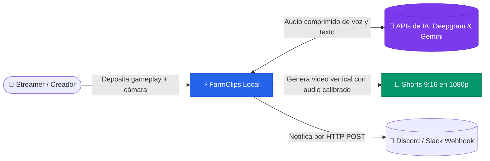

# 🏠 FarmClips — Arquitectura Híbrida

> [!abstract] En pocas palabras
> Sistema automatizado que convierte grabaciones largas de videojuegos en Shorts verticales virales para TikTok, YouTube Shorts y Reels con estilo Hormozi Gaming, combinando inteligencia artificial ligera en la nube con procesamiento multimedia 100 % local.

| 📌 Estado | 👤 Responsable | 🗓️ Actualizado | 🔗 Repositorio / Código |
|---|---|---|---|
| En producción (v2.0.0) | Equipo FarmClips | 2026-11-07 | `ClipsApp` (Monorepo unificado) |

---

## 🧭 ¿Por dónde empiezo?

| Si eres… | Lee primero | Luego |
|---|---|---|
| 👩‍💼 **De negocio / Streamer** | [[Resumen ejecutivo]] | [[Alcance y objetivos]] |
| 🆕 **Nuevo desarrollador** | [[Primeros pasos]] | [[Arquitectura general]] |
| 🛠️ **Soporte o DevOps** | [[Runbooks]] | [[Despliegue y Ejecución]] |
| 🤔 **Buscas un término o concepto** | [[Glosario]] | [[FAQ]] |

---

## 🗺️ El proyecto de un vistazo

> [!tip] Vista visual completa e interactiva
> Abre el mapa del proyecto en Obsidian: ![[Mapa del proyecto.canvas]]

---

## 📚 Mapa de Contenidos del Vault

- 🎯 **[[Visión general]]**: Propuesta de valor, objetivos del sistema, matriz de actores RACI y [[Glosario]] central.
- 🏗️ **[[Arquitectura]]**: Diagramas de contexto C4, separación de los 3 pools y catálogo de [[Componentes]].
- 🔄 **[[Flujos y procesos]]**: Pipeline en 6 fases continuas, desde la ingesta hasta la entrega de video normalizado.
- 📊 **[[Datos]]**: Modelo relacional SQLite WAL, esquemas de archivos Parquet y fórmulas de cálculo de puntuación y sonoridad.
- 🧭 **[[Guías]]**: Tutoriales prácticos paso a paso para arrancar, usar el editor interactivo y renderizar clips.
- 🚑 **[[Operación]]**: Monitoreo de eventos en tiempo real, control de presupuesto y catálogo de [[Runbooks]].
- ⚖️ **[[Decisiones]]**: Registro de decisiones de diseño de arquitectura (ADR) con sus motivos y alternativas descartadas.
- 📖 **[[Referencia]]**: Especificación de endpoints REST/SSE, variables de entorno y comandos de terminal.
- 🗂️ **[[Recursos]]**: Preguntas frecuentes resueltas ([[FAQ]]) e [[Historial de cambios]].

---

## 🔔 Novedades recientes
- **2026-11-07**: Lanzamiento de la versión 2.0.0 con monorepo unificado, motor de edición declarativo EditPlan v2, renderizado acelerado en C++ (`FastCompositor`), normalización en 2 pasadas a -14 LUFS y panel de ajustes en caliente `/settings` → [[Historial de cambios]].