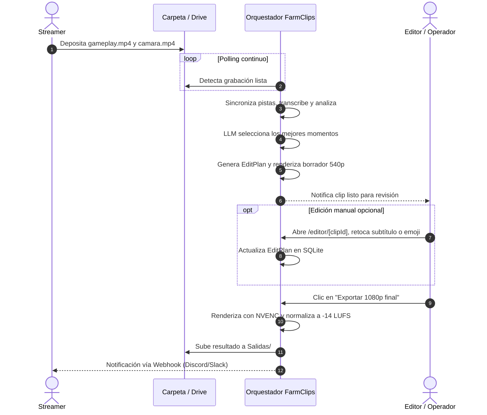

# Actores y responsables (Matriz RACI)

> [!abstract] En pocas palabras
> Define quién interviene en el ciclo de vida de un clip, qué papel desempeña cada persona o componente automatizado y cómo se coordinan entre sí.

---

## 👥 Perfiles y roles

| Rol | Descripción | Responsabilidad principal |
|---|---|---|
| **Streamer / Creador** | Jugador que transmite y genera el contenido audiovisual crudo. | Asegurar que el gameplay y la cámara se graben correctamente con micrófono limpio. |
| **Operador / Editor de video** | Usuario humano que supervisa los resultados y realiza ajustes finos. | Revisar los borradores en `/editor/[clipId]`, ajustar textos, emojis y aprobar exportación. |
| **Administrador técnico / DevOps** | Responsable de la infraestructura local, configuración y APIs. | Gestionar API Keys, monitorear el presupuesto en `/settings` y mantener el software. |
| **Orquestador autónomo** | Motor en background de FarmClips (FastAPI + Asyncio). | Detectar archivos nuevos, coordinar los 3 pools de trabajo, registrar eventos SSE y entregar clips. |

---

## 📊 Matriz RACI del sistema

> **R** = Responsable (lo hace) · **A** = Aprueba (da el visto bueno) · **C** = Consultado · **I** = Informado

| Actividad del flujo | Streamer | Operador / Editor | Admin / DevOps | Orquestador Autónomo |
|---|:---:|:---:|:---:|:---:|
| **Grabar partida (`gameplay` + `camara`)** | **R** | I | I | – |
| **Subir a Drive o carpeta local** | **R** | I | I | I |
| **Detección e ingesta automática** | I | I | I | **R** |
| **Sincronización acústica ([[Glosario#XCorr FFT\|XCorr FFT]])** | – | I | – | **R** |
| **Transcripción de voz ([[Glosario#STT\|STT]])** | – | – | I | **R** |
| **Curación narrativa con [[Glosario#LLM\|LLM]]** | – | I | I | **R** |
| **Tracking facial en CPU ([[Glosario#MediaPipe\|MediaPipe]])** | – | – | – | **R** |
| **Generación del [[Glosario#EditPlan\|EditPlan v2]]** | – | I | – | **R** |
| **Ajuste de textos, emojis y encuadre** | – | **R** | – | I |
| **Renderizado final (1080p, [[Glosario#NVENC\|NVENC]])** | – | A | – | **R** |
| **Entrega en Drive `Salidas/` y Webhook** | I | I | I | **R** |
| **Configurar API Keys y presupuestos** | – | C | **R** | I |
| **Limpieza de temporales ([[Glosario#TTL\|TTL]])** | – | – | I | **R** |

---

## 🧭 Flujo de interacción humana y automática

---

## 🔗 Relacionado
- [[Resumen ejecutivo]]
- [[Alcance y objetivos]]
- [[Cómo usar el Editor Web Studio]]
- [[Monitoreo y Presupuesto]]