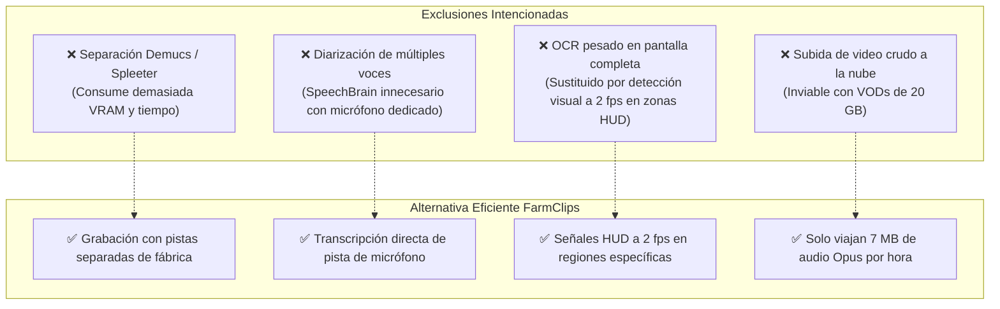

# Alcance y objetivos del sistema

> [!abstract] En pocas palabras
> Delimita exactamente qué hace FarmClips, qué entra y qué queda fuera de forma intencionada para mantener el software rápido, económico, confiable y fácil de operar.

---

## 🎯 Objetivos principales

1. **Automatizar la extracción de valor**: Identificar y extraer momentos virales de partidas de juego completas sin intervención humana en menos de 10 minutos por sesión.
2. **Máxima calidad visual vertical**: Producir videos en relación $9:16$ ($1080 \times 1920$) con encuadre facial inteligente, composición dinámica de juego y subtitulado animado con estilo **[[Glosario#Hormozi Gaming|Hormozi Gaming]]**.
3. **Cero saturación de red**: Permitir que creadores con conexiones de subida domésticas estándar operen con fluidez procesando los archivos pesados localmente.
4. **Control estricto de costos de IA**: Ofrecer un flujo transparente donde cada llamada a la API quede registrada con su costo en dólares y protegida contra cobros duplicados mediante **[[Glosario#Idempotencia|idempotencia]]**.

---

## 📥 Entradas admitidas por el sistema

| Recurso | Formato / Requisitos | Propósito |
|---|---|---|
| **Video de juego (`gameplay.mp4`)** | MP4 / MKV, 1080p o 1440p, 60 fps | Captura limpia de la partida y audio del juego. |
| **Video de cámara (`camara.mp4`)** | MP4 / MKV / MOV, cámara frontal y voz | Fuente visual del rostro y audio del micrófono. |
| **Pistas de audio separadas** | Opcional: stream 0 (voz) y stream 1 (juego) | Sincronización automática de alta fidelidad. |
| **Carpetas en Google Drive** | Subcarpetas con ambos archivos nombrados | Detección automática en la nube e ingesta programada. |

---

## 📤 Salidas producidas

| Producto | Características | Destino |
|---|---|---|
| **Shorts en alta definición (1080p)** | $1080 \times 1920$, 60 fps, H.264, $-14\text{ LUFS}$ | Carpeta local `data/sessions/<id>/renders/` y Drive `Salidas/` |
| **Borradores rápidos (540p)** | $540 \times 960$, 30 fps, render instantáneo | Previsualización en `/editor/[clipId]` |
| **EditPlan declarativo** | JSON v2 con todas las capas y tiempos | Base de datos SQLite y editor web |
| **Artefactos analíticos** | Parquet con señales de euforia y tracking | Almacenamiento local para auditoría |
| **Notificaciones en tiempo real** | Webhook HTTP POST con títulos y links | Servidor de Discord, Slack o CMS |

---

## 🚫 Lo que NO hace deliberadamente (Límites de diseño)

Para asegurar la estabilidad y el rendimiento en ordenadores convencionales, FarmClips tomó las siguientes decisiones de exclusión explícitas:

> [!example] Caso práctico: Micrófono dedicado vs. Separación Demucs
> En lugar de tomar una pista estéreo mezclada y aplicar 45 minutos de inferencia neuronal en GPU para extraer la voz del streamer, FarmClips exige que la cámara o el software de grabación (OBS Studio) capture la voz del micrófono en una pista y el juego en otra. Esto reduce el tiempo de preparación de 45 minutos a solo **30 segundos** con **[[Glosario#FFmpeg|FFmpeg]]**.

---

## 🔗 Relacionado
- [[Resumen ejecutivo]]
- [[Actores y responsables]]
- [[Arquitectura general]]
- [[ADR-001 Arquitectura Híbrida IA Nube y Proceso Local]]