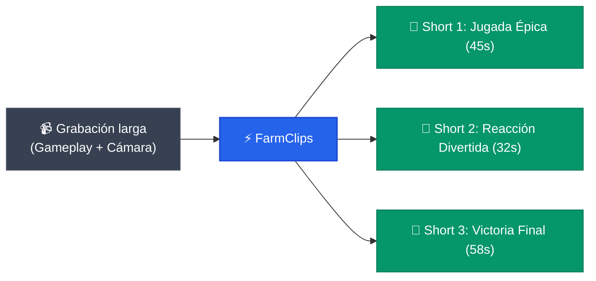

# Resumen ejecutivo: FarmClips

> [!abstract] En pocas palabras
> FarmClips transforma grabaciones largas de videojuegos en videos verticales virales para TikTok, Shorts y Reels en menos de 5 minutos, combinando inteligencia artificial en la nube para entender las historias con procesamiento en la propia computadora para no gastar ancho de banda ni comprometer la privacidad.

---

## 🎯 ¿Qué es FarmClips?

FarmClips es una plataforma de software diseñada para creadores de contenido y streamers de videojuegos que graban sus sesiones con dos fuentes de video independientes:
1. **La pantalla del juego** (`gameplay.mp4`) en resolución panorámica $1920 \times 1080$.
2. **La cámara del jugador** (`camara.mp4`) con su micrófono integrado.

El sistema ingesta automáticamente estas grabaciones (desde carpetas locales o sincronizadas con Google Drive), analiza la voz y los momentos de mayor euforia, y genera de 3 a 10 **[[Glosario#Shorts|Shorts]]** verticales ($1080 \times 1920$) listos para publicar, con el estilo audiovisual **[[Glosario#Hormozi Gaming|Hormozi Gaming]]**: títulos llamativos, subtítulos animados con resaltado dinámico, emojis contextuales y un volumen equilibrado a **[[Glosario#LUFS|-14 LUFS]]**.

---

## 💡 ¿Por qué es diferente? (Propuesta de valor)

A diferencia de los editores automáticos tradicionales que suben gigabytes de video a la nube o que saturan la tarjeta gráfica con modelos pesados, FarmClips aplica una **[[Glosario#Arquitectura Híbrida|arquitectura híbrida estricta]]**:

1. **El video nunca sale de tu equipo**: Solo se envían a la nube unos 7 megabytes de audio comprimido en Opus por cada hora de grabación ($16\text{ kHz}$ mono) y una transcripción resumida en texto. No requiere subir archivos de video de 10 a 30 GB.
2. **Costo por sesión controlado**: Cada sesión de 2 horas cuesta aproximadamente **\$0.15 a \$0.30 USD** en APIs de IA. Incluye un límite de seguridad estricto configurable (por defecto **\$9.00 USD**).
3. **Cero separación costosa de voces**: Al trabajar con fuentes nativas separadas (`gameplay.mp4` y `camara.mp4`), prescinde de algoritmos pesados como Demucs o diarizaciones que consumirían horas de computación.
4. **Edición instantánea sin re-renderizar**: Gracias al contrato declarativo **[[Glosario#EditPlan|EditPlan v2]]**, el creador puede abrir el editor web (`/editor/[clipId]`), ajustar textos, mover el encuadre y escuchar la mezcla de audio en tiempo real antes de exportar el video final.

> [!example] Ejemplo real de procesamiento
> En una partida de 90 minutos de *Valorant*, el juego ocupa 12 GB y la cámara 8 GB. FarmClips extrae 11 MB de audio de la cámara, lo envía a transcribir a Deepgram Nova-3 (costo: \$0.04 USD) y procesa la selección narrativa con Gemini 3.5 Flash-Lite (costo: \$0.02 USD). El sistema detecta 6 jugadas clave, rastrea el rostro del jugador en CPU y entrega los 5 mejores Shorts en 1080p en menos de 4 minutos con aceleración NVENC.

---

## ⚙️ Principios arquitectónicos clave

> [!info]- Detalle técnico (clic para expandir)
> - **Sincronización acústica**: Utiliza **[[Glosario#XCorr FFT|XCorr FFT]]** sobre pistas de audio a 16 kHz para emparejar la línea temporal del juego con la de la cámara con precisión de milisegundos.
> - **Selección lingüística segura**: El LLM no maneja números de coma flotante; selecciona listas de identificadores **[[Glosario#ID de Frase|IDs de frase]]** (`u0001` .. `u9999`). El motor local calcula los bordes y ajusta el corte exacto en el **[[Glosario#Ataque Acústico|ataque acústico]]** a 100 Hz.
> - **Tracking facial ultraligero**: Ejecuta **[[Glosario#MediaPipe|MediaPipe Face Detector]]** exclusivamente en los fragmentos de los clips elegidos (con 2 segundos de margen), reduciendo el análisis a 15 fps sobre frames de 640 px y estabilizando el encuadre mediante **[[Glosario#One Euro Filter|One Euro Filter]]** y **[[Glosario#RDP|RDP]]**.
> - **Normalización sonora**: Filtro **[[Glosario#Loudnorm|loudnorm]]** de **[[Glosario#FFmpeg|FFmpeg]]** en dos pasadas lineales para fijar $-14\text{ LUFS}$ y True Peak de $-1.0\text{ dBTP}$.

---

## 📊 Estado actual del proyecto

| Indicador | Valor actual | Objetivo |
|---|---|---|
| **Versión** | 2.0.0 (Monorepo unificado) | Producción estable v2 |
| **Tiempo de entrega por clip** | 35 – 50 segundos (NVENC) | < 60 segundos |
| **Consumo de ancho de banda** | ~7 MB por hora de grabación | < 10 MB/h |
| **Precisión de sincronización** | $\pm 10\text{ ms}$ (XCorr FFT) | < 25 ms |
| **Límite presupuestario** | \$9.00 USD (configurable en caliente) | Cero sobrecostos |

---

## 🔗 Relacionado
- [[Alcance y objetivos]]
- [[Actores y responsables]]
- [[Glosario]]
- [[Arquitectura general]]
- [[Primeros pasos]]