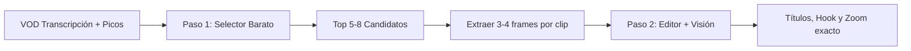

# Plan de Mejora: Calidad de Clips, Costos y Personalización

> [!abstract] En pocas palabras
> Este plan define cómo reducir el costo de la IA en **ClipsApp** (evaluando alternativas como DeepSeek) y cómo lograr clips mucho más retenedores y personalizados para cada streamer, aprendiendo de sus clips pasados y de tus correcciones en el editor.

---

## 1. Optimización de Costos de API (LLM)

En ClipsApp, el modelo de lenguaje **solo recibe texto** (la transcripción compacta y marcas de picos) y devuelve un JSON estructurado. No usa visión ni audio directo de Gemini, por lo que no dependemos de un único proveedor.

### Comparativa de tarifas (por 1M de tokens)

| Proveedor / Modelo | Input (1M) | Output (1M) | Cache Hit (1M) | JSON Estricto |
| :--- | :---: | :---: | :---: | :--- |
| **Gemini 3.5 Flash-Lite** *(actual)* | `$0.30` | `$2.50` | `$0.03` | Nativo (`responseJsonSchema`) |
| **Gemini 3.1 Flash-Lite** | `$0.25` | `$1.50` | `$0.025` | Nativo (`responseJsonSchema`) |
| **DeepSeek Flash** *(Off-peak)* | **`$0.15`** | **`$0.60`** | **`$0.003`** | Solo `json_object` |
| **DeepSeek Flash** *(Peak)* | `$0.30` | `$1.20` | `$0.006` | Solo `json_object` |
| **DeepSeek V4 Pro** *(Off-peak)* | `$0.66` | `$1.98` | `$0.022` | Solo `json_object` |
| **OpenAI `gpt-6-luna`** *(backup actual)* | `$0.25` | `$2.00` | N/A | Nativo (`strict: True`) |

> [!info]- Detalle técnico: Ajustes necesarios para usar DeepSeek en FarmClips
> El proyecto ya cuenta con `OpenAICompatibleAdapter` en `packages/providers/clipsproviders/llm/openai_compat.py` con fallback automático de `json_schema` a `json_object`. Para usar DeepSeek de forma precisa falta:
> 1. Agregar las tarifas de `deepseek-chat` / `deepseek-flash` en `OPENAI_PRICING_PER_1M` (hoy usa el fallback `($0.30, $2.00)`, lo que sobreestima el gasto en `CLIPS_MAX_BUDGET_USD`).
> 2. Validar/adaptar el envío de `max_tokens` frente a `max_completion_tokens` según el endpoint de DeepSeek.
> 3. Exponer `deepseek` como opción directa en `CLIPS_LLM_PRIMARY` (`apps/server/clipsserver/config.py`) y en la vista `/settings`.

---

## 2. Plan para Potenciar Cortes y Edición

### Fase 1: Mejorar el Contexto y los Cortes (Mayor impacto inmediato)

1. **Visibilidad de pausas y emoción en el timeline (`timeline/builder.py`):**
   - Insertar marcas explícitas de silencio entre frases (ej. `[PAUSA 3.5s]`) para que la IA detecte cierres de escena y no mezcle temas distintos.
   - Añadir etiquetas de reacción junto a las frases clave (ej. `[ALTA REACCIÓN]`, `[GRITO/RISA]`).
2. **Corte final guiado por decaimiento de audio (`selection/resolver.py`):**
   - Evitar que `adjust_utterance_span` expanda clips cortos (`< 20s`) hacia adelante/atrás a ciegas metiendo relleno.
   - Ajustar el `tail_pad` dinámicamente según la energía de `signals.reaction` / micrófono: si el streamer sigue riendo, esperar a que baje la energía; si hay silencio, hacer corte seco (`0.2s–0.3s`).

> [!example] Ejemplo de corte inteligente
> Si un chiste termina en el segundo `17.5` con una carcajada que decae en el `19.2`, el corte se cierra en `19.4` (aunque no llegue a 20s), evitando incluir 3 segundos de charla posterior sobre el chat que arruinan el remate.

---

### Fase 2: Curación en 2 Pasos (*Two-Pass*) + Visión Selectiva

1. **Paso 1 (Selector barato):** Usar DeepSeek Flash o Gemini Flash-Lite únicamente para detectar los rangos candidatos (`start_id`, `end_id`, `score`).
2. **Paso 2 (Editor + Visión sobre los ganadores):** Solo para los 5–8 mejores clips, extraer 3–4 frames clave (inicio, clímax, remate) en baja resolución y enviarlos a un modelo con visión/copywriting superior para redactar el `overlay_title`, `hook` y decidir con certeza si el `zoom_focus` debe ir a `face` o `game`.

---

### Fase 3: Edición Automática de Alta Retención (`directors/hormozi.py`)

1. **Cold Open / Hook inicial (1.2s–1.8s):** En clips donde el clímax ocurre tarde, duplicar un micro-adelanto del momento explosivo al segundo `0:00` antes de arrancar el contexto.
2. **Jump Cuts sub-segundo:** Pasar la protección de risas/gritos de resolución de 1 segundo a **100 ms** usando el RMS directo del micrófono, permitiendo cortes de silencios más agresivos (`0.35s–0.45s`) sin mutilar respiraciones ni risas.
3. **Dinamismo de cámara y título:** Alternar intencionalmente entre `split`, `game` y `face` según el ritmo, y ocultar/reducir el `overlay_title` después de los primeros 3–4 segundos para limpiar la pantalla.
4. **SFX sincronizados al ataque:** Disparar *whoosh* en cambios de layout y *pop/impact* exactamente en el `zoom_word` usando `snap_word_starts_to_attack`.

---

## 3. Personalización por Creador ("Entrenamiento" sin Fine-Tuning)

No hace falta reentrenar pesos de un modelo neuronal. Se logra mayor personalización y compatibilidad multi-proveedor con un **sistema de memoria por creador** en tres capas:

1. **Perfil del Creador (`CreatorProfile`):**
   - Guarda jerga, apodos, juegos habituales, tipo de humor y reglas de estilo de títulos.
   - Alimenta automáticamente `CLIPS_KEYTERMS` en el STT para transcribir bien sus palabras clave.
2. **Banco de "Golden Clips" (*Few-Shot Dinámico*):**
   - Permite marcar clips aprobados o importar clips exitosos del streamer.
   - Al analizar un VOD nuevo de ese creador, se inyectan sus **3–5 ejemplos más representativos** (transcripción + corte exacto + título + `zoom_focus`) justo después del prompt estático del sistema para conservar *Prompt Caching*.
3. **Aprendizaje silencioso desde el Editor (`/editor/[clipId]`):**
   - Guardar el diff automático entre la propuesta original de la IA y la versión final que tú exportas o descartas (ej. cuánto recortaste al inicio/fin, cómo reescribiste el título o si cambiaste `face` por `game`).
   - Con esos diffs se generan reglas aprendidas por creador (ej. *"Prefiere títulos cortos sin signos de exclamación; en shooters prioriza zoom en `game`"*).

> [!info]- Detalle técnico: Impacto en base de datos y UI
> - **SQLite:** Tablas `highlight_runs`, `highlight_revisions` y `highlight_profiles` en `clipsserver/experimental/storage.py` para registrar tanto revisiones explícitas (`ClipReview`) como diffs de edición del estudio (`edicion_estudio`).
> - **UI:** Desplegable **Valorar clip** (`ClipReview.tsx`) en `/sessions/[id]`, comparador offline en `/experimental/highlights`, edición por tramo en `/editor/[clipId]` y selector de modelos DeepSeek en `/settings`.

---

## 📤 Qué salió de aquí

- [[EP-04 Selección Editorial Calidad de Clips y Aprendizaje Continuo]]
- [[HU-014 Selección editorial recopilaciones y aprendizaje con optimización de costos]]

---

## 🔗 Relacionado
- [[EP-04 Selección Editorial Calidad de Clips y Aprendizaje Continuo]]
- [[HU-014 Selección editorial recopilaciones y aprendizaje con optimización de costos]]
- [[Flujo 3 Curación con LLM]]
- [[Flujo 4 Tracking y Generación EditPlan]]
- [[Cómo configurar Proveedores de IA]]
- [[ADR-002 Selección por IDs de Frase en LLM]]
- [[ADR-004 Formato EditPlan Declarativo v2]]
- [[Requerimientos]]
