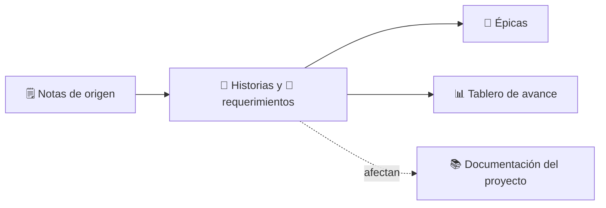

# 📋 Requerimientos

> [!abstract] Qué encontrarás aquí
> Qué se va a construir (historias de usuario y requerimientos), agrupado en épicas, y en qué va cada cosa.
> El avance al día está en **[[Tablero de avance]]**.

## 🗺️ Cómo está organizado

| Estado | Significa |
|---|---|
| ⚪ Sin iniciar | Identificada, aún no planificada |
| 🔵 Por hacer | Lista y planificada (prioridad y fechas) |
| 🟡 En progreso | Alguien trabaja en ella |
| 🟣 En revisión | Construida; se verifican los criterios de aceptación |
| 🟢 Hecho | Todos los criterios de aceptación cumplidos |
| 🔴 Bloqueado | No puede avanzar (el motivo está en la historia) |
| ⚫ Descartado | Se decidió no hacerla (se conserva el registro) |

<!-- inicio:indice-automatico (lo regenera requerimientos.py) -->

## 🧩 Épicas

| Épica | Avance | Ítems |
|---|---|---|
| [[EP-02 Claridad y Experiencia de Usuario en Web Studio\|EP-02]] Claridad y Experiencia de Usuario en Web Studio | `██████████ 100 %` | 2 |

## 🗒️ Notas de origen

- [[2026-11-07 Editor interactivo WYSIWYG reencuadre visual y rendimiento 60 fps]]
- [[2026-11-07 Textos claros y digeribles en la plataforma]]

<!-- fin:indice-automatico -->

⬅️ Volver a [[00 - Inicio]]
