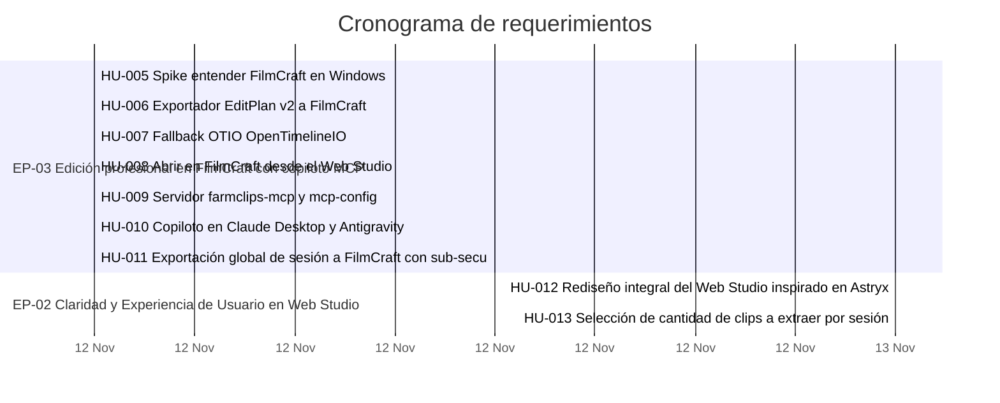

# 📊 Tablero de avance

> [!tip] Cómo leer este tablero
> Se genera solo a partir de cada historia (estado, fechas y criterios de aceptación marcados).
> Para cambiar algo, edita la historia, no este tablero. Puedes escribir notas propias **fuera** del bloque automático.

<!-- inicio:tablero-automatico (no editar a mano: lo regenera requerimientos.py) -->

> [!abstract] Avance general al 2026-11-13
> **████████████████████ 99 %** · 12 ítems · 11 hechos · 1 en curso · 0 por hacer · 0 sin iniciar
> Sin estimaciones en puntos todavía.

## 🧩 Épicas

| Épica | Avance | Ítems | Fechas |
|---|---|---|---|
| [[EP-02 Claridad y Experiencia de Usuario en Web Studio\|EP-02]] Claridad y Experiencia de Usuario en Web Studio | `██████████ 97 %` | 5 | 2026-11-07 → 2026-11-13 |
| [[EP-03 Edición profesional en FilmCraft con copiloto MCP\|EP-03]] Edición profesional en FilmCraft con copiloto MCP | `██████████ 100 %` | 7 | 2026-11-12 → 2026-11-12 |

## 📋 Tablero

### 🔴 Bloqueado (0)
_Ninguno._

### 🟡 En progreso (0)
_Ninguno._

### 🟣 En revisión (1)
| ID | Título | Prioridad | Responsable | Avance | Fin |
|---|---|---|---|---|---|
| [[HU-004 Edición confiable de clips tramos frases y guardado automático\|HU-004]] | Edición confiable de clips tramos frases y guardado automático | ⬆️ Alta | Equipo FarmClips | `█████████░ 86 %` | — |

### 🔵 Por hacer (0)
_Ninguno._

### ⚪ Sin iniciar (0)
_Ninguno._

### 🟢 Hecho (11)
| ID | Título | Prioridad | Responsable | Avance | Fin |
|---|---|---|---|---|---|
| [[HU-002 Simplificación y lenguaje claro en toda la plataforma\|HU-002]] | Simplificación y lenguaje claro en toda la plataforma | ⬆️ Alta | Equipo FarmClips | `██████████ 100 %` | — |
| [[HU-003 Editor interactivo WYSIWYG reencuadre visual y rendimiento 60 fps\|HU-003]] | Editor interactivo WYSIWYG reencuadre visual y rendimiento 60 fps | ⬆️ Alta | Equipo FarmClips | `██████████ 100 %` | — |
| [[HU-005 Spike entender FilmCraft en Windows\|HU-005]] | Spike entender FilmCraft en Windows | ⬆️ Alta | Equipo FarmClips | `██████████ 100 %` | 2026-11-12 |
| [[HU-006 Exportador EditPlan v2 a FilmCraft\|HU-006]] | Exportador EditPlan v2 a FilmCraft | ⬆️ Alta | Equipo FarmClips | `██████████ 100 %` | 2026-11-12 |
| [[HU-008 Abrir en FilmCraft desde el Web Studio\|HU-008]] | Abrir en FilmCraft desde el Web Studio | ⬆️ Alta | Equipo FarmClips | `██████████ 100 %` | 2026-11-12 |
| [[HU-009 Servidor farmclips-mcp y mcp-config\|HU-009]] | Servidor farmclips-mcp y mcp-config | ⬆️ Alta | Equipo FarmClips | `██████████ 100 %` | 2026-11-12 |
| [[HU-011 Exportación global de sesión a FilmCraft con sub-secuencias\|HU-011]] | Exportación global de sesión a FilmCraft con sub-secuencias | ⬆️ Alta | Equipo FarmClips | `██████████ 100 %` | 2026-11-12 |
| [[HU-012 Rediseño integral del Web Studio inspirado en Astryx de Meta\|HU-012]] | Rediseño integral del Web Studio inspirado en Astryx de Meta | ⬆️ Alta | Equipo FarmClips | `██████████ 100 %` | 2026-11-13 |
| [[HU-013 Selección de cantidad de clips a extraer por sesión\|HU-013]] | Selección de cantidad de clips a extraer por sesión | ⬆️ Alta | Equipo FarmClips | `██████████ 100 %` | 2026-11-13 |
| [[HU-007 Fallback OTIO OpenTimelineIO\|HU-007]] | Fallback OTIO OpenTimelineIO | ➖ Media | Equipo FarmClips | `██████████ 100 %` | 2026-11-12 |
| [[HU-010 Copiloto en Claude Desktop y Antigravity\|HU-010]] | Copiloto en Claude Desktop y Antigravity | ➖ Media | Equipo FarmClips | `██████████ 100 %` | 2026-11-12 |

## 📅 Cronograma

> [!info]- Sin fechas planificadas (3)
> - [[HU-002 Simplificación y lenguaje claro en toda la plataforma|HU-002]] Simplificación y lenguaje claro en toda la plataforma · Hecho
> - [[HU-003 Editor interactivo WYSIWYG reencuadre visual y rendimiento 60 fps|HU-003]] Editor interactivo WYSIWYG reencuadre visual y rendimiento 60 fps · Hecho
> - [[HU-004 Edición confiable de clips tramos frases y guardado automático|HU-004]] Edición confiable de clips tramos frases y guardado automático · En revisión

<!-- fin:tablero-automatico -->

## 🔗 Relacionado
- [[Requerimientos]]
