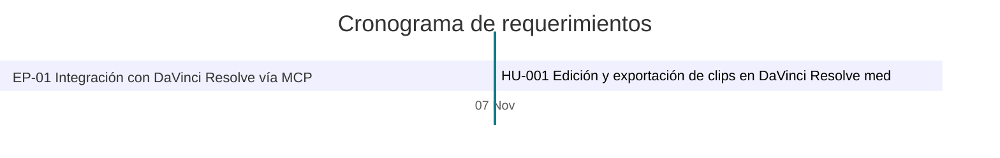

# 📊 Tablero de avance

> [!tip] Cómo leer este tablero
> Se genera solo a partir de cada historia (estado, fechas y criterios de aceptación marcados).
> Para cambiar algo, edita la historia, no este tablero. Puedes escribir notas propias **fuera** del bloque automático.

<!-- inicio:tablero-automatico (no editar a mano: lo regenera requerimientos.py) -->

> [!abstract] Avance general al 2026-11-07
> **████████████████████ 100 %** · 1 ítem · 1 hecho · 0 en curso · 0 por hacer · 0 sin iniciar
> Puntos: 8 de 8 completados.

## 🧩 Épicas

| Épica | Avance | Ítems | Fechas |
|---|---|---|---|
| [[EP-01 Integración con DaVinci Resolve vía MCP\|EP-01]] Integración con DaVinci Resolve vía MCP | `██████████ 100 %` | 1 | 2026-11-07 → 2026-11-07 |

## 📋 Tablero

### 🔴 Bloqueado (0)
_Ninguno._

### 🟡 En progreso (0)
_Ninguno._

### 🟣 En revisión (0)
_Ninguno._

### 🔵 Por hacer (0)
_Ninguno._

### ⚪ Sin iniciar (0)
_Ninguno._

### 🟢 Hecho (1)
| ID | Título | Prioridad | Responsable | Avance | Fin |
|---|---|---|---|---|---|
| [[HU-001 Edición y exportación de clips en DaVinci Resolve mediante MCP local\|HU-001]] | Edición y exportación de clips en DaVinci Resolve mediante MCP local | ⬆️ Alta | Sebas | `██████████ 100 %` | 2026-11-07 |

## 📅 Cronograma

<!-- fin:tablero-automatico -->

## 🔗 Relacionado
- [[Requerimientos]]
