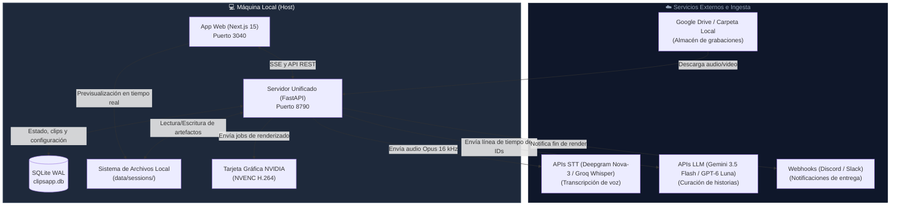
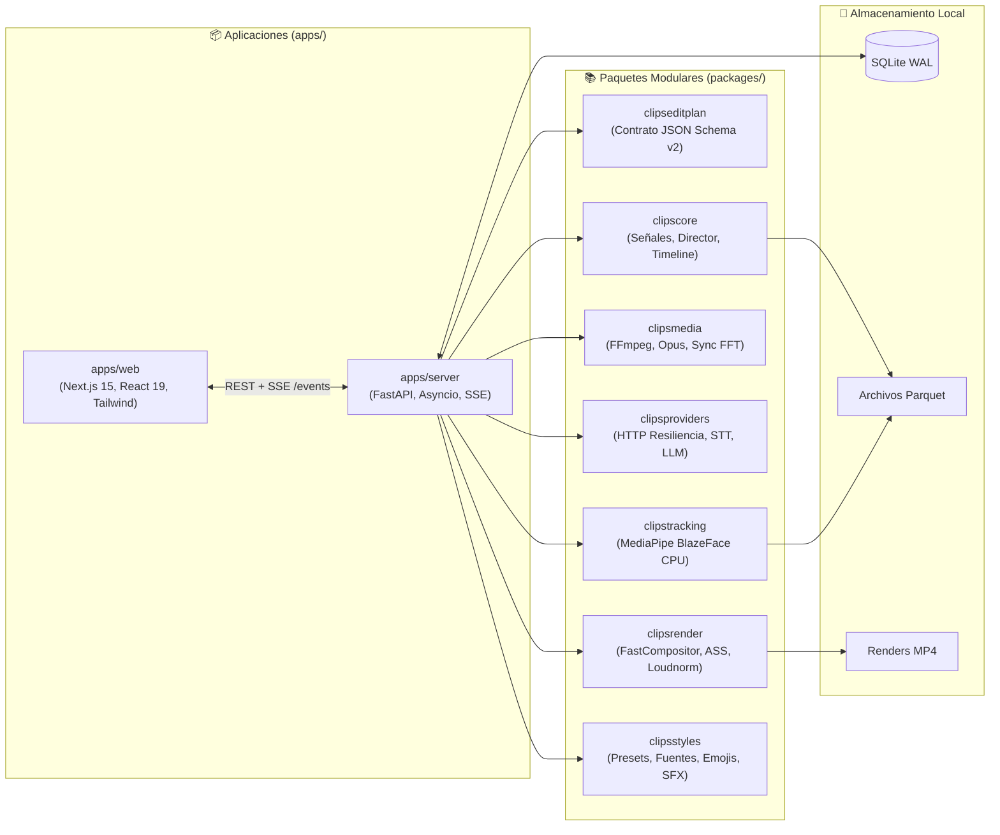

# Arquitectura general de FarmClips

> [!abstract] En pocas palabras
> FarmClips divide el trabajo de forma radical: la inteligencia y comprensión de lenguaje viajan por internet en paquetes diminutos hacia modelos de IA, mientras que el renderizado, corte de video y análisis facial ocurren íntegramente dentro de tu computadora para máxima velocidad y cero costo de almacenamiento en la nube.

---

## 🗺️ Diagrama de contexto del sistema (C4 Nivel 1)

---

## 🏗️ Diagrama de contenedores y separación de capas (C4 Nivel 2)

El sistema se estructura en dos aplicaciones principales y un monorepo modular de paquetes en Python y TypeScript:

---

## ⚙️ Los 3 Pools de Trabajo Aislados

Para evitar que una tarea pesada congele al servidor o bloquee la interfaz gráfica, el servidor organiza el trabajo en tres grupos de ejecución con políticas de concurrencia independientes:

1. **`ApiPool` (`asyncio` + `httpx`)**:
   - Gestiona todas las llamadas de red externas.
   - Aplica limitación triple: concurrencia máxima, peticiones por minuto (RPM) y control de presupuesto en USD.
   - Detecta errores `429` respetando el encabezado `Retry-After`.
   - En caso de payload demasiado grande (`413`), subdivide el archivo de audio automáticamente.
   - Conmuta a proveedores de respaldo si el proveedor principal falla.
2. **`CpuPool` (`ProcessPoolExecutor`, núcleos disponibles $- 1$)**:
   - Dedicado al cómputo numérico intensivo sin sufrir el bloqueo del GIL de Python.
   - Ejecuta extracción de envolventes de audio a 100 Hz, detección de movimiento en video a 2 fps mediante OpenCV y tracking facial con **[[Glosario#MediaPipe|MediaPipe]]**.
   - Almacena series temporales comprimidas en formato Parquet.
3. **`RenderPool` (Cola priorizada para GPU y CPU)**:
   - Controla el acceso a los slots de codificación de la GPU (**[[Glosario#NVENC|NVENC]]**, típicamente 2 o 3 sesiones simultáneas).
   - Degrada de forma segura a codificación por software (**[[Glosario#libx264|libx264]]**) con límite de núcleos si no hay hardware NVIDIA disponible.

> [!example] Asignación en una computadora típica de 8 núcleos con GPU RTX 4060
> - `ApiPool`: Gestiona hasta 8 peticiones HTTP concurrentes hacia Deepgram y Gemini.
> - `CpuPool`: Utiliza 7 procesos paralelos para computar las señales Parquet y rastrear el rostro en los clips elegidos.
> - `RenderPool`: Limita a 2 renders simultáneos con NVENC a 1080p, encolando el resto según la puntuación de calidad del clip.

---

## 🛡️ Seguridad y protección de datos

> [!info]- Detalle técnico (clic para expandir)
> - **Enmascaramiento de credenciales**: En la base de datos y la interfaz de configuración (`/settings`), las claves de API nunca se exponen completas (se almacenan y transmiten como `AIza...8a9b` o `sk-...3f1a`).
> - **Aislamiento de red**: El servidor solo se expone por defecto en la interfaz local de bucle invertido (`127.0.0.1:8790`).
> - **Idempotencia mediante Hash SHA-256**: Todo archivo de entrada y artefacto intermedio genera una firma determinista basada en su ruta absoluta, tamaño en bytes y fecha de modificación en nanosegundos (`mtime_ns`). Si el hash ya existe en la tabla `artifacts`, no se recalculan datos.

---

## 🔗 Relacionado
- [[FastAPI y Orquestador]]
- [[Pools de Trabajo]]
- [[Motor de Edición Web Studio]]
- [[Integraciones]]
- [[ADR-001 Arquitectura Híbrida IA Nube y Proceso Local]]