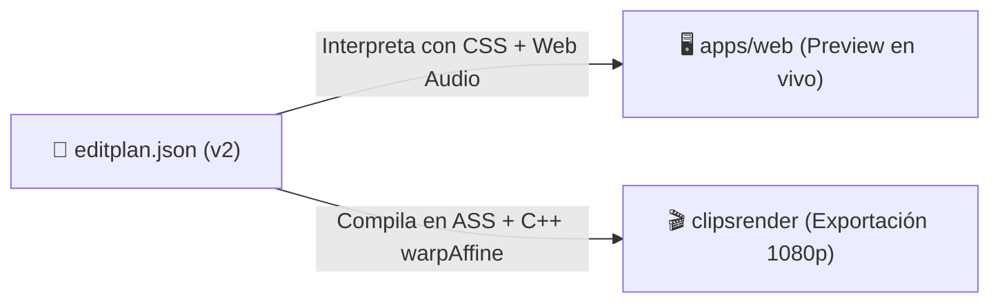

# Contrato declarativo EditPlan v2 (`clipseditplan`)

> [!abstract] En pocas palabras
> Es el documento digital estructurado que describe cómo debe verse y sonar un clip de video. Define qué fragmentos cortar, cómo encuadrar la cámara, qué palabras subtitular con qué colores y qué efectos de sonido aplicar, separando la creatividad de la exportación final.

---

## 🎯 ¿Por qué un contrato declarativo?

En los sistemas tradicionales de video, cambiar el color de un subtítulo o mover el encuadre 10 píxeles requiere volver a cortar el video desde cero. 

En FarmClips, **EditPlan v2** es un objeto JSON inmutable y determinista:
- Tanto el estudio web en Next.js como el motor de renderizado en C++/FFmpeg leen el mismo archivo.
- Permite reproducir el resultado de inmediato en el navegador con CSS y Canvas.
- Si solo cambias el estilo visual, **no se vuelve a llamar a la IA ni se repite el tracking facial**.



---

## 📜 Estructura del JSON Schema (v2)

El contrato se define con Pydantic en Python (`packages/editplan/clipseditplan/models.py`) y genera automáticamente tipos TypeScript para el frontend:

```json
{
  "version": 2,
  "clip_id": "clip_01_clutch_final",
  "source": {
    "session": "session_20261107_partida01",
    "ranges": [[184.25, 212.80], [214.10, 228.45]]
  },
  "output": {
    "w": 1080,
    "h": 1920,
    "fps": 60,
    "style": "hormozi-gaming"
  },
  "layout": [
    {"t": 0.0, "kind": "split", "camera_ratio": 0.40}
  ],
  "camera_crop": [
    {"t": 0.0, "cx": 0.52, "cy": 0.43, "zoom": 1.25, "ease": "inOutSine"}
  ],
  "captions": {
    "preset": "hormozi",
    "groups": [
      {
        "words": [
          {"w": "¡NO", "s": 0.12, "e": 0.45, "emphasis": true},
          {"w": "PUEDE", "s": 0.46, "e": 0.78},
          {"w": "SER!", "s": 0.79, "e": 1.20, "emphasis": true}
        ],
        "emoji": {"id": "1f631", "at": 0.50}
      }
    ]
  },
  "overlays": [
    {"kind": "title", "text": "CLUTCH IMPOSIBLE 1v3", "start": 0.0, "end": 3.0}
  ],
  "audio": {
    "mic_gain_db": 2.0,
    "duck_game_db": -9.0,
    "sfx": [{"t": 0.12, "id": "boom", "gain_db": -4.0}]
  }
}
```

---

## 🧭 Funciones de conversión temporal del contrato

El modelo Pydantic incluye métodos matemáticos bidireccionales indispensables para el salto de silencios (**[[Glosario#Jump Cut|Jump Cuts]]**):

1. **`master_to_clip_time(master_t)`**:
   Traduce un segundo del video original largo ($185.0\text{ s}$) al segundo local del clip editado ($0.75\text{ s}$). Si el segundo cayó dentro de un silencio eliminado, devuelve `None`.
2. **`clip_to_master_time(clip_t)`**:
   Dado un segundo del clip vertical ($15.4\text{ s}$), determina en qué rango de corte se encuentra y devuelve el segundo original exacto de la grabación de la cámara.
3. **`plan_hash(style_hash, quality)`**:
   Calcula un hash SHA-256 canónico del plan. Si el hash ya está renderizado en `data/render_cache/`, la exportación es instantánea.

---

## 🔗 Relacionado
- [[Arquitectura general]]
- [[Núcleo de Señales y Selección]]
- [[Motor de Edición Web Studio]]
- [[Motor de Renderizado y Subtítulos]]
- [[ADR-004 Formato EditPlan Declarativo v2]]