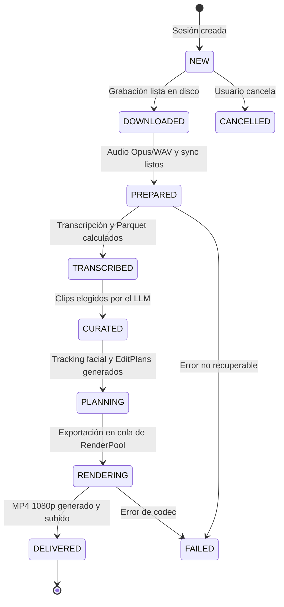

# FastAPI y Orquestador del servidor

> [!abstract] En pocas palabras
> Es el cerebro central de FarmClips: una aplicación en FastAPI que ejecuta el ciclo de vida de cada sesión, almacena estados y tareas en una base de datos SQLite y transmite el progreso a la pantalla mediante eventos en tiempo real.

---

## 🎯 Propósito del componente

Ubicado en `apps/server/clipsserver/`, este componente tiene tres funciones primordiales:
1. **Exponer la API HTTP y el bus de eventos [[Glosario#SSE|SSE]]** para alimentar el estudio web en Next.js.
2. **Coordinar el ciclo de 7 pasos del pipeline**: Ingesta $\rightarrow$ Preparación $\rightarrow$ Transcripción/Señales $\rightarrow$ Curación $\rightarrow$ Tracking facial $\rightarrow$ Compilación del EditPlan $\rightarrow$ Render y entrega.
3. **Garantizar resiliencia y recuperación automática**: Si la máquina se apaga o el proceso se interrumpe, el orquestador reanuda las sesiones pendientes sin perder datos ni repetir cálculos ya terminados.

---

## ⚙️ Máquina de estados de una sesión

Toda sesión de video transiciona a través de estados predecibles en la base de datos:

---

## 🛠️ Recuperación de arrendamientos (*Leases*) e idempotencia

El orquestador implementa un sistema de control de tareas en SQLite (`tasks`):
- Cuando una tarea intensiva inicia (p. ej. computar señales de audio), se registra un **arrendamiento temporal** (*lease*) con duración estimada (p. ej. 600 segundos).
- Si el servidor se reinicia abruptamente mientras una tarea estaba en ejecución, la función `recover_expired_leases()` detecta la marca de tiempo caducada y reanuda o reinicia únicamente la subtarea afectada.
- Cada archivo producido se asocia a su hash determinista en la tabla `artifacts`. Si el archivo existe físicamente en disco y coincide con la firma, se omite el re-cálculo.

> [!info]- Detalle técnico de configuración dinámica (Hot-Reload)
> El módulo `config.py` implementa la función `update_dotenv_values()`. Cuando el usuario cambia una clave de API o modifica el presupuesto en la interfaz web (`POST /settings`), los cambios se escriben directamente en el archivo `.env` del proyecto y se recargan en memoria en caliente (`reload_settings()`), afectando inmediatamente a los pools sin necesidad de reiniciar el proceso de Python.

---

## 🔗 Relacionado
- [[Arquitectura general]]
- [[Pools de Trabajo]]
- [[Referencia API REST y SSE]]
- [[Modelo de datos]]