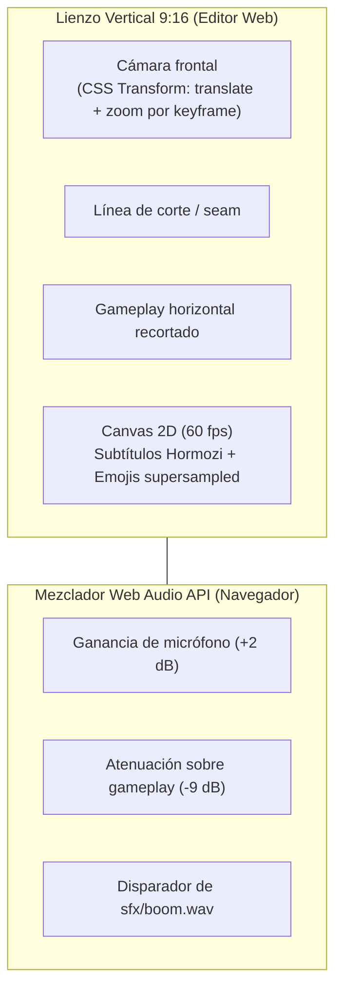

# Motor de Edición Web Studio (`apps/web`)

> [!abstract] En pocas palabras
> Es la interfaz visual en Next.js 15 donde los creadores revisan y ajustan sus clips en tiempo real. Reproduce el video vertical combinando las fuentes originales con transformaciones CSS y mezclando el sonido en el navegador con la Web Audio API, sin obligarte a esperar un renderizado completo cada vez que cambias un subtítulo.

---

## 🎨 Pantallas principales de la aplicación

La app web corre por defecto en `http://127.0.0.1:3040` y consta de las siguientes rutas:
- `/sessions`: Listado general de grabaciones procesadas, en curso y fallidas, con barra de progreso general.
- `/sessions/[id]`: Vista de detalle de una sesión, ranking de clips curados con sus puntuaciones y botón de reprocesamiento.
- `/editor/[clipId]`: Estudio de edición interactivo de un clip particular.
- `/settings`: Panel de control dinámico para editar API Keys, seleccionar modelos y configurar límites de presupuesto sin tocar archivos de texto a mano.
- `/analytics`: Métricas de consumo de tokens, uso de cuota en dólares y tiempos promedio de renderizado.

---

## ⚡ Reproductor Declarativo de Alto Rendimiento

En lugar de renderizar un archivo de video temporal en el disco cada vez que el usuario mueve un control, el editor `/editor/[clipId]` superpone los dos videos originales (`gameplay.mp4` y `camara.mp4`) en un contenedor vertical de aspect ratio $9:16$:

---

## 🛠️ Capacidades interactivas y optimizaciones a 60 fps

1. **Desacoplamiento del loop a 60 fps respecto a React**: El ciclo `requestAnimationFrame` actualiza directamente mediante referencias DOM (`scrubberInputRef`, `timeLabelRef`, `playheadBarRef`) la barra de tiempo y el cursor visual a 60 Hz, sincronizando el estado de React a una tasa controlada (~8 Hz) para eliminar *micro-stutters* y reconciliaciones innecesarias del Virtual DOM.
2. **Caché de métricas tipográficas en `<canvas>` (`wordWidthCacheRef`)**: Precalcula y memoriza el ancho en píxeles (`ctx.measureText`) de cada palabra y tamaño de fuente para evitar recalcular la geometría tipográfica en cada fotograma.
3. **Inicio, final y cortes del clip**: El bloque *Inicio y final del clip* cambia el tramo de la grabación y enciende o apaga los **[[Glosario#Jump Cut|Jump Cut]]**; el servidor regenera el plan (`POST /clips/{id}/retime`) conservando el texto corregido y el título.
4. **Catálogo de 42 emojis RGBA con caché inmutable**: Selector visual para sustituir o añadir iconos animados en cualquier segundo del video (servidos con `Cache-Control: immutable`).
5. **Exportación bajo demanda (síncrona o en segundo plano)**: Botón para solicitar renderizado borrador (540p) o final (1080p con NVENC), soportando encolado no bloqueante (`async_mode`).
6. **Experiencia de usuario con lenguaje claro y digerible**: Toda la interfaz (`/sessions`, `/editor/[clipId]`, `/settings`, `/analytics` y mensajes SSE del backend) explica el «por qué» detrás de cada control y proceso en lenguaje natural para creadores de gaming, sustituyendo tecnicismos y siglas crudas por resultados visuales y auditivos tangibles.
7. **Event Bus SSE unificado y aceleración por GPU (`SharedSseManager` y `GlassCard`)**: Un único socket persistente EventSource en cliente compartido por toda la aplicación distribuye eventos en memoria a `TopNav`, páginas y modales sin abrir múltiples conexiones HTTP/1.1 (evitando agotar el límite de 6 conexiones del navegador). Se combina con tarjetas `GlassCard` aceleradas en GPU (`transform-gpu`, `backdrop-blur-md`) y desacoplamiento de diagnósticos en `/settings` para ofrecer 60 fps constantes y carga inmediata (< 10 ms).
8. **Reencuadre Directo de Cámara y Subtítulos WYSIWYG**: El usuario interactúa directamente sobre el visor vertical $9:16$ con el puntero del ratón (`PointerEvents` con `setPointerCapture`) para centrar su rostro y mover la altura del bloque de subtítulos (`vertical_ratio` persistido en `EditPlan.captions` y respetado en el renderizado final de FFmpeg y C++ FastCompositor). Incluye una **guía magnética de centrado** que encaja suavemente en $cx = 0.50$ con una línea vertical dorada y control de zoom continuo con la rueda del ratón (`wheel`).
9. **Plantillas Rápidas de Disposición (1 Clic)**: Barra de ajustes inmediatos para alternar entre *Clásico Gaming* (40/60 split), *Gameplay Prioritario* (25/75), *Reacción Total* (100% cámara 2s) y *Juego Completo* (100% gameplay) sin necesidad de editar manualmente los bloques de la línea temporal.
10. **Sincronización a 60 FPS sin Jitter (Hardware Master Clock)**: La cámara actúa como reloj maestro continuo evitando reasignar forzadamente `video.currentTime` en cada cuadro de animación; el video secundario del juego solo se sincroniza cuando la deriva temporal supera los $40\text{ ms}$, eliminando micro-parones en decodificadores GPU locales y aprovechando `requestVideoFrameCallback` cuando el navegador lo soporta.
11. **Mezclador de Audio Intuitivo e Historial de Deshacer/Rehacer**: Controles visuales con deslizador de volumen de voz ($0\%$ a $150\%$), selector de atenuación del juego (Apagado, Suave, Normal, Fuerte) y atajos `Ctrl+Z` / `Ctrl+Shift+Z` / `Ctrl+Y` / `Espacio`. Un arrastre o una palabra corregida es un solo paso de deshacer.
12. **Corrección de frases completas**: Además de cada palabra, una frase puede reescribirse con otro número de palabras; su tiempo se reparte según el largo de cada palabra para que el resaltado tipo karaoke siga al audio.
13. **Guardado automático**: 2.5 s después del último cambio (nunca durante un arrastre, un guardado o un render) y aviso del navegador al salir con cambios sin guardar.

> [!info]- Detalle técnico: dónde vive la lógica del editor
> `apps/web/src/lib/editor/`:
> - `useEditHistory.ts`: plan + deshacer/rehacer (máx. 30 pasos). `planRef` se actualiza en el acto, así el bucle de 60 fps, los arrastres y las llamadas asíncronas siempre leen el último plan. Nada se registra dentro de un actualizador de `setState` (en `StrictMode` corre dos veces).
> - `useEditorShortcuts.ts`: atajos con *handlers* leídos de una referencia (evita el `togglePlay` viejo que impedía pausar con `Espacio`).
> - `useAutosave.ts`: temporizador de guardado y aviso `beforeunload`.
> - `captionText.ts`: `retextCaptionGroup` (misma cantidad de palabras: conserva tiempos y énfasis; distinta: reparte el tiempo).
>
> En pausa `requestVideoFrameCallback` no se dispara, así que cada cambio del plan repinta el visor y refresca la etiqueta de tiempo.

---

## 🔗 Relacionado
- [[FastAPI y Orquestador]]
- [[Contrato EditPlan v2]]
- [[Cómo usar el Editor Web Studio]]
- [[Sistema de Estilos y Presets]]
- [[HU-002 Simplificación y lenguaje claro en toda la plataforma|HU-002]]
- [[HU-003 Editor interactivo WYSIWYG reencuadre visual y rendimiento 60 fps|HU-003]]
- [[HU-004 Edición confiable de clips tramos frases y guardado automático|HU-004]]