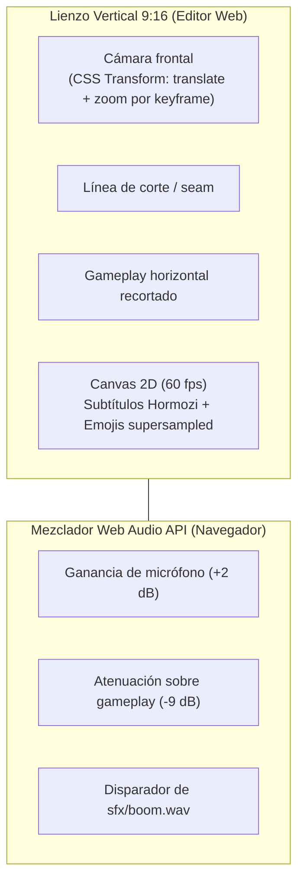

# Motor de Edición Web Studio (`apps/web`)

> [!abstract] En pocas palabras
> Es la interfaz visual en Next.js 15 donde los creadores revisan y ajustan sus clips en tiempo real. Reproduce el video vertical combinando las fuentes originales con transformaciones CSS y mezclando el sonido en el navegador con la Web Audio API, sin obligarte a esperar un renderizado completo cada vez que cambias un subtítulo.

---

## 🎨 Pantallas principales de la aplicación

La app web corre por defecto en `http://127.0.0.1:3040` y consta de las siguientes rutas:
- `/sessions`: Listado general de grabaciones procesadas, en curso y fallidas, con barra de progreso general.
- `/sessions/[id]`: Vista de detalle de una sesión, ranking de clips curados con sus puntuaciones y botón de reprocesamiento.
- `/editor/[clipId]`: Estudio de edición interactivo de un clip particular.
- `/settings`: Panel de control dinámico para editar API Keys, seleccionar modelos y configurar límites de presupuesto sin tocar archivos de texto a mano.
- `/analytics`: Métricas de consumo de tokens, uso de cuota en dólares y tiempos promedio de renderizado.

---

## ⚡ Reproductor Declarativo de Alto Rendimiento

En lugar de renderizar un archivo de video temporal en el disco cada vez que el usuario mueve un control, el editor `/editor/[clipId]` superpone los dos videos originales (`gameplay.mp4` y `camara.mp4`) en un contenedor vertical de aspect ratio $9:16$:

---

## 🛠️ Capacidades interactivas del editor

1. **Línea de tiempo de palabras recortables**: Cada palabra de la frase puede activarse o desactivarse; si se desactiva, el reproductor aplica un salto milimétrico instantáneo (**[[Glosario#Jump Cut|Jump Cut]]**).
2. **Catálogo de 42 emojis RGBA**: Selector visual para sustituir o añadir iconos animados en cualquier segundo del video (emojis escalados a $128 \times 128\text{ px}$).
3. **Editor de títulos y badges**: Cambio de tipografía, tamaño de letra y texto de la cabecera del clip.
4. **Exportación bajo demanda**: Botón para solicitar renderizado borrador (540p en 10 segundos) o renderizado final (1080p con NVENC).

---

## 🔗 Relacionado
- [[FastAPI y Orquestador]]
- [[Contrato EditPlan v2]]
- [[Cómo usar el Editor Web Studio]]
- [[Sistema de Estilos y Presets]]