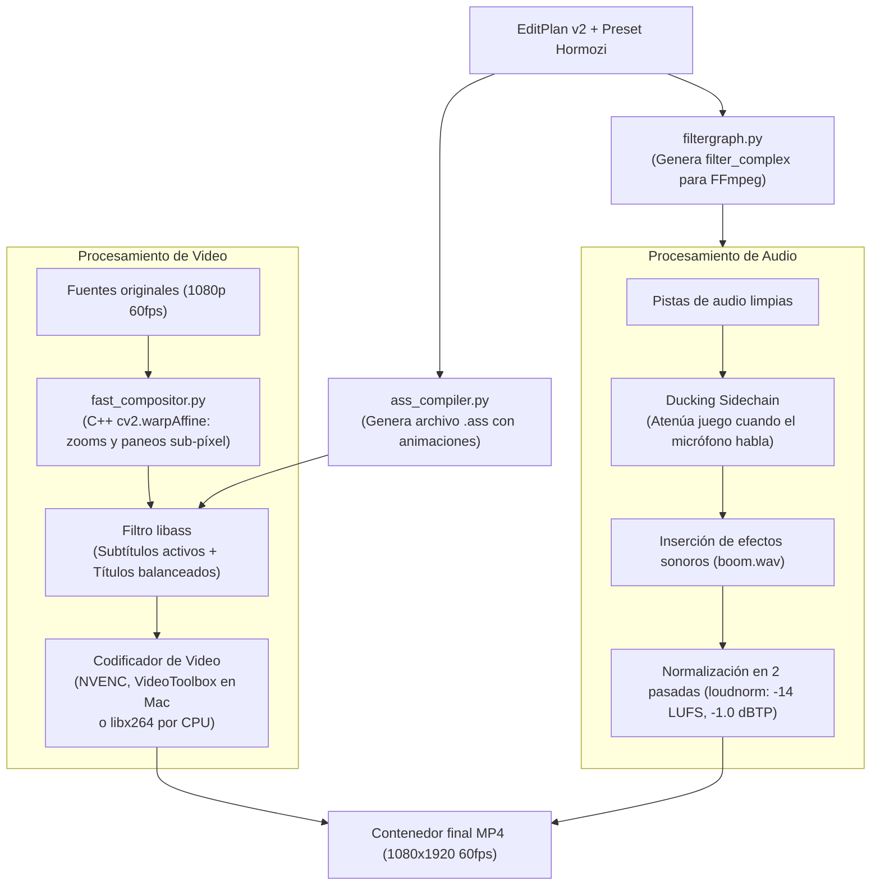

# Motor de Renderizado y Subtítulos (`clipsrender`)

> [!abstract] En pocas palabras
> Es la fábrica final de video de FarmClips. Une los fragmentos elegidos, encuadra las cámaras con aceleración en C++, quema subtítulos animados con estilo Hormozi mediante [[Glosario#libass|libass]] y normaliza el sonido en dos pasadas a [[Glosario#LUFS|-14 LUFS]] para que suene perfecto en redes sociales.

---

## 🏗️ Flujo de Composición y Codificación



---

## 🎨 1. Compilador de Subtítulos ASS (`ass_compiler.py`)

Genera scripts compatibles con el estándar Advanced SubStation Alpha (`.ass`) interpretados por [[Glosario#libass|libass]]:
- **Resaltado palabra por palabra**:
  Utiliza etiquetas de control de tiempo y color de ASS:
  - Color blanco base: `&H00FFFFFF`
  - Palabra activa hablada: Amarillo brillante `&H0000D4FF` (`#FFD400`)
  - Palabra con énfasis emocional: Verde fluorescente `&H0014FF39` (`#39FF14`) con escalado dinámico (`\fscx115\fscy115`).
- **Títulos balanceados en el seam**:
  Calcula el punto de unión (*seam*) entre la cámara superior y el juego inferior, colocando allí el título durante los primeros 3 segundos con transición suave (`\fad(120, 200)`). Si el título supera los 18 caracteres, la función `balance_title_lines()` divide las líneas buscando una longitud visual simétrica.

---

## 🚀 2. Compositor Acelerado C++ (`fast_compositor.py`)

Aplica paneos y transiciones de cámara (*zoom in*, *zoom out*) con curvas matemáticas de aceleración (`inOutSine`, `outBack`):
- Se apoya en transformaciones afines directas en C++ a través de OpenCV (`cv2.warpAffine` con interpolación lineal/bicúbica).
- **Pool de buffers YUV420p preasignados (`free_buffers`)**: Reutiliza un anillo fijo de 10 matrices `np.ndarray` en memoria (`cv2.cvtColor(..., dst=yuv_buf)`) entre el hilo compositor y el escritor de tubería hacia FFmpeg, eliminando ~5 GB de asignaciones dinámicas de RAM por cada clip renderizado.
- **Aceleración por hardware en decodificación**: Solicita `cv2.VIDEO_ACCELERATION_ANY` en `_SequentialVideoSampler` y transmite matrices de píxeles directamente hacia la entrada de codificación [[Glosario#NVENC|NVENC]].

---

## 🎞️ Elección del codificador por plataforma

`LocalFfmpegRenderBackend.encoder_chain()` arma la lista de codificadores a intentar, en orden, y pasa al siguiente si uno falla:

| Sistema | Cadena |
|---|---|
| Windows / Linux | [[Glosario#NVENC|NVENC]] (si `CLIPS_NVENC` está activo) → [[Glosario#libx264|libx264]] |
| macOS | NVENC (si existiera) → [[Glosario#VideoToolbox|VideoToolbox]] (si `CLIPS_VIDEOTOOLBOX` está activo y FFmpeg lo trae) → libx264 |

> [!example] Calidad medida con [[Glosario#VMAF|VMAF]] (clip de 24 s, Mac)
> - Final 1080p: libx264 CRF 19 → 97.67 (mín. 94.96) en 6.7 s; VideoToolbox `-q:v 75` → 97.98 (mín. 96.19) en 3.9 s.
> - Borrador 540p: libx264 *veryfast* CRF 25 → 93.63 (mín. 89.39) en 2.2 s; VideoToolbox `-q:v 55` → 95.15 (mín. 92.64) en 1.7 s.

> [!info]- Detalle técnico
> `videotoolbox_available()` (en caché) devuelve `False` si `sys.platform != "darwin"` o si `ffmpeg -encoders` no lista `h264_videotoolbox`, así que en Windows la cadena es idéntica a la anterior. Pruebas: `tests/test_encoder_selection.py`.

---

## 🔊 3. Mezcla de Audio y Normalización en 2 Pasadas (`runner.py`)

1. **[[Glosario#Ducking Sidechain|Ducking Sidechain]]**:
   Aplica un filtro compresor donde la voz del streamer actúa como disparador de la compresión sobre la pista de audio del videojuego:
   ```text
   [game][mic]sidechaincompress=threshold=0.03:ratio=4:attack=20:release=250[ducked_game]
   ```
2. **Normalización Lineal en 2 Pasadas con [[Glosario#Loudnorm|loudnorm]]**:
   - *Pasada 1*: Analiza el archivo mezclado completo midiendo sonoridad integrada real (`I`), rango de sonoridad (`LRA`) y pico verdadero (`TP`).
   - *Pasada 2*: Aplica la normalización lineal exacta inyectando los valores medidos:
     ```text
     loudnorm=I=-14:LRA=11:TP=-1.0:measured_I=-18.4:measured_LRA=9.2:measured_TP=-2.1:linear=true
     ```
   Esto asegura que el audio final cumpla estrictamente los estándares de TikTok y YouTube en [[Glosario#LUFS|-14 LUFS]] sin provocar "bombeos" ni saturaciones acústicas desagradables.

---

## 🔗 Relacionado
- [[Contrato EditPlan v2]]
- [[Sistema de Estilos y Presets]]
- [[Pools de Trabajo]]
- [[Flujo 6 Renderizado y Normalización]]