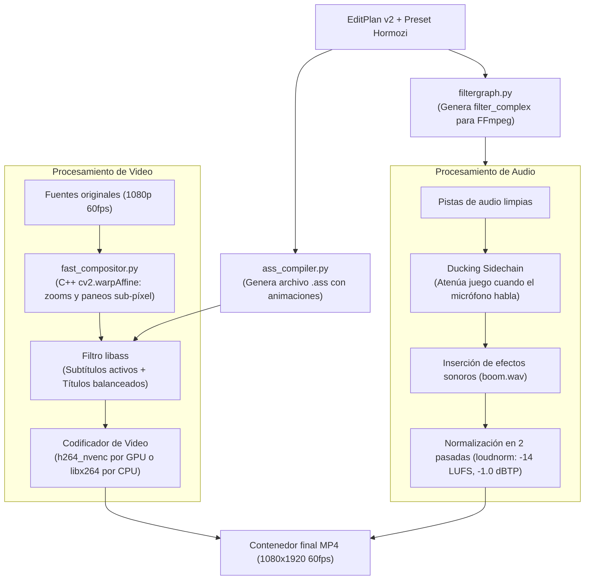

# Motor de Renderizado y Subtítulos (`clipsrender`)

> [!abstract] En pocas palabras
> Es la fábrica final de video de FarmClips. Une los fragmentos elegidos, encuadra las cámaras con aceleración en C++, quema subtítulos animados con estilo Hormozi mediante [[Glosario#libass|libass]] y normaliza el sonido en dos pasadas a [[Glosario#LUFS|-14 LUFS]] para que suene perfecto en redes sociales.

---

## 🏗️ Flujo de Composición y Codificación



---

## 🎨 1. Compilador de Subtítulos ASS (`ass_compiler.py`)

Genera scripts compatibles con el estándar Advanced SubStation Alpha (`.ass`) interpretados por [[Glosario#libass|libass]]:
- **Resaltado palabra por palabra**:
  Utiliza etiquetas de control de tiempo y color de ASS:
  - Color blanco base: `&H00FFFFFF`
  - Palabra activa hablada: Amarillo brillante `&H0000D4FF` (`#FFD400`)
  - Palabra con énfasis emocional: Verde fluorescente `&H0014FF39` (`#39FF14`) con escalado dinámico (`\fscx115\fscy115`).
- **Títulos balanceados en el seam**:
  Calcula el punto de unión (*seam*) entre la cámara superior y el juego inferior, colocando allí el título durante los primeros 3 segundos con transición suave (`\fad(120, 200)`). Si el título supera los 18 caracteres, la función `balance_title_lines()` divide las líneas buscando una longitud visual simétrica.

---

## 🚀 2. Compositor Acelerado C++ (`fast_compositor.py`)

Aplica paneos y transiciones de cámara (*zoom in*, *zoom out*) con curvas matemáticas de aceleración (`inOutSine`, `outBack`):
- Se apoya en transformaciones afines directas en C++ a través de OpenCV (`cv2.warpAffine` con interpolación lineal/bicúbica).
- **Pool de buffers YUV420p preasignados (`free_buffers`)**: Reutiliza un anillo fijo de 10 matrices `np.ndarray` en memoria (`cv2.cvtColor(..., dst=yuv_buf)`) entre el hilo compositor y el escritor de tubería hacia FFmpeg, eliminando ~5 GB de asignaciones dinámicas de RAM por cada clip renderizado.
- **Aceleración por hardware en decodificación**: Solicita `cv2.VIDEO_ACCELERATION_ANY` en `_SequentialVideoSampler` y transmite matrices de píxeles directamente hacia la entrada de codificación [[Glosario#NVENC|NVENC]].

---

## 🔊 3. Mezcla de Audio y Normalización en 2 Pasadas (`runner.py`)

1. **[[Glosario#Ducking Sidechain|Ducking Sidechain]]**:
   Aplica un filtro compresor donde la voz del streamer actúa como disparador de la compresión sobre la pista de audio del videojuego:
   ```text
   [game][mic]sidechaincompress=threshold=0.03:ratio=4:attack=20:release=250[ducked_game]
   ```
2. **Normalización Lineal en 2 Pasadas con [[Glosario#Loudnorm|loudnorm]]**:
   - *Pasada 1*: Analiza el archivo mezclado completo midiendo sonoridad integrada real (`I`), rango de sonoridad (`LRA`) y pico verdadero (`TP`).
   - *Pasada 2*: Aplica la normalización lineal exacta inyectando los valores medidos:
     ```text
     loudnorm=I=-14:LRA=11:TP=-1.0:measured_I=-18.4:measured_LRA=9.2:measured_TP=-2.1:linear=true
     ```
   Esto asegura que el audio final cumpla estrictamente los estándares de TikTok y YouTube en [[Glosario#LUFS|-14 LUFS]] sin provocar "bombeos" ni saturaciones acústicas desagradables.

---

## 🎬 4. Puente de Edición en DaVinci Resolve vía MCP (`resolve_mcp.py`)

Permite trasladar la edición de video hacia **DaVinci Resolve** (Free o Studio) ejecutándose localmente en el PC del creador mediante el protocolo **MCP (Model Context Protocol, JSON-RPC 2.0)** y el selector `CLIPS_EDITOR_BACKEND` (`local` | `resolve_mcp` | `both`):
- **Servidor MCP Integrado (`clipsserver resolve-mcp` / `ResolveMcpServer`)**: Expone las herramientas MCP `resolve_get_status`, `resolve_open_project`, `resolve_import_media`, `resolve_build_vertical_timeline`, `resolve_add_timeline_markers` y `resolve_trigger_render` por `stdio` o `http`.
- **Detección no invasiva de proyecto activo**: Consulta `pm.GetCurrentProject()` antes de invocar `LoadProject`. Si el usuario ya tiene un proyecto abierto en DaVinci Resolve, importa los medios directamente sobre este sin forzar el cierre del proyecto ni disparar cuadros modales de guardado que congelaban la API.
- **Aislamiento en bin dedicado de MediaPool**: Los archivos de gameplay, cámara y audios se importan organizadamente dentro de la subcarpeta `FarmClips` del MediaPool, evitando mezclar artefactos en la raíz del usuario.
- **Despacho asíncrono no bloqueante y eventos SSE**: Los endpoints `POST /clips/{clip_id}/resolve` y `POST /sessions/{session_id}/resolve` soportan `async_mode: true`. Devuelven una respuesta inmediata (`< 50ms`) con estado `queued` y notifican el progreso en tiempo real mediante eventos SSE (`resolve_mcp_progress` y `clip_resolve_exported`), impidiendo que peticiones HTTP síncronas agoten las conexiones del navegador y congelen la reproducción de video en Web Studio.
- **Protección de IPC, Sondeo Out-of-Process y Caché TTL (`DaVinciResolveScript`)**: Ejecuta la comprobación de conectividad mediante un subproceso aislado con límite estricto de 0.6s y caché TTL de 30 segundos, impidiendo que la librería nativa `fusionscript.dll` bloquee el GIL de Python en el servidor principal. Permite que `GET /resolve/status` responda en **0.8 ms** y que las demás peticiones del servidor no sufran pausas.
- **Compilador de Paquete Local Auto-contenido (`compile_fcpxml_v19`, `compile_srt`, `compile_resolve_python_script`)**: Genera en `data/sessions/<sid>/clips/<clip_id>/resolve/` un archivo `.fcpxml` v1.9 multipista (`V1` Gameplay, `V2` Cámara sincronizada con reencuadre facial, `V3` Títulos, `A1` Micrófono, `A2` Audio de juego con ducking, `A3` Efectos SFX y marcadores de IA), subtítulos `.srt`/`.ass` y el script `resolve_build_timeline.py` compatible con la consola `Py3` de DaVinci Resolve Free.

---

## 🔗 Relacionado
- [[Contrato EditPlan v2]]
- [[Sistema de Estilos y Presets]]
- [[Pools de Trabajo]]
- [[Flujo 6 Renderizado y Normalización]]
- [[HU-001 Edición y exportación de clips en DaVinci Resolve mediante MCP local|HU-001]]