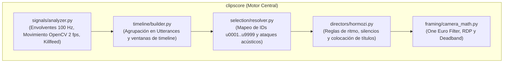

# Núcleo de Señales y Selección (`clipscore`)

> [!abstract] En pocas palabras
> Es el motor matemático y narrativo de FarmClips. Analiza la euforia en la voz y el movimiento del juego a 100 Hz, compacta la transcripción en un formato ultra liviano para el LLM y traduce las decisiones del modelo de IA en cortes de video exactos al milisegundo.

---

## 🎯 Estructura de módulos (`packages/core/clipscore/`)



---

## 📊 1. Analizador de Señales (`signals/analyzer.py`)

Genera una serie temporal completa por cada segundo de la grabación VOD y la serializa en formato Apache Parquet (`signals.parquet`):
- **`mic_loudness` y `mic_burst`**: Calculados sobre la pista WAV a 16 kHz mediante envolventes RMS con ventanas de 10 ms. Miden volumen sostenido y gritos repentinos de emoción.
- **`game_loudness`**: Volumen de los efectos sonoros y disparos del juego.
- **`motion` y `motion_cx`**: Cuantificación del flujo óptico o diferencia de cuadros a 2 fps en el gameplay para detectar tiroteos o giros rápidos de cámara.
- **`hud_activity`**: Análisis focalizado en la esquina superior derecha (típica zona de *Killfeed* en juegos como Valorant o CS2) para detectar bajas sucesivas.
- **`excitement`**: Función combinada ponderada:
  $$\text{excitement}(t) = 0.40 \cdot \text{mic\_burst} + 0.25 \cdot \text{reaction} + 0.20 \cdot \text{motion} + 0.15 \cdot \text{hud}$$

---

## 📝 2. Constructor de Línea de Tiempo y Poda por Señales (`timeline/builder.py`)

Transforma miles de palabras individuales en una transcripción estructurada en frases (**[[Glosario#Utterance|Utterances]]**):
- Asigna un identificador corto y único (`u0001`, `u0002`, ..., `u9999`).
- Fusiona silencios naturales de respiración ($< 0.4\text{ s}$).
- **Poda en 2 etapas por clusters de señales (`prune_utterances_by_signal_clusters`)**: En grabaciones largas ($\ge 10\text{ min}$), filtra automáticamente las zonas muertas sin picos acústicos ni actividad en el juego, conservando ventanas contextuales ($[-45\text{ s}, +60\text{ s}]$) alrededor de los núcleos de alta energía. Esto ahorra entre un **65 % y un 85 % adicional de tokens de entrada** en streams extensos.
- Compacta el texto para enviar al LLM:
  ```text
  u0045 [4:12] ¡No puede ser, viene por la espalda!
  >>> PICO [4:14] (score=0.94 mic=0.88 juego=0.72)
  u0046 [4:15] ¡Doble baja, bro, ganamos la ronda!
  ```

---

## ⏱️ 3. Resolvedor de Tiempos e Inferencia en CPU (`selection/resolver.py`)

El LLM devuelve una propuesta como `{"start_id": "u0045", "end_id": "u0046"}`. El resolvedor local realiza el trabajo de precisión:
1. Extrae la primera palabra de `u0045` y la última de `u0046`.
2. **Enriquecimiento local de énfasis y emojis (`infer_local_emphasis_and_emojis`)**: Si el LLM devuelve un JSON minificado sin `emphasis_words`, `emojis`, `hook` o `hashtags`, el resolvedor analiza las palabras del fragmento en CPU y asigna automáticamente las palabras clave de énfasis y sus códigos hex del catálogo de 42 emojis (`1f525`, `1f3c6`, `1f3af`, `1f480`, etc.) con costo \$0.00.
3. **Ajuste del ataque acústico**: Retrocede entre 50 y 150 ms en la envolvente sonora a 100 Hz para encontrar el punto de silencio exacto antes de la primera consonante explosiva.
4. **Márgenes de seguridad y validación de duración**: Añade *padding* configurable y ajusta los bordes de frase para mantener el clip dentro de $[20\text{ s}, 60\text{ s}]$.

---

## 🔗 Relacionado
- [[Arquitectura general]]
- [[Contrato EditPlan v2]]
- [[Proveedores de IA y Resiliencia]]
- [[Tracking Facial en CPU]]
- [[ADR-002 Selección por IDs de Frase en LLM]]