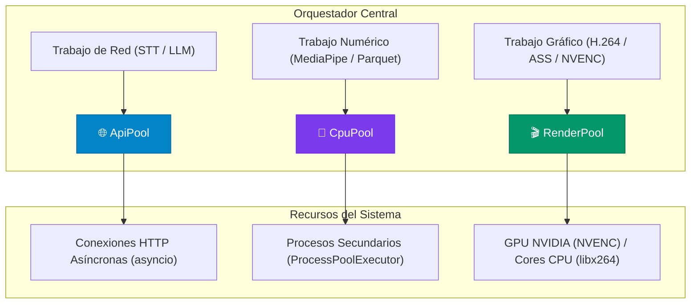

# Pools de Trabajo (`ApiPool`, `CpuPool`, `RenderPool`)

> [!abstract] En pocas palabras
> Son los tres motores de ejecución independientes de FarmClips. Cada uno tiene asignada una clase de tarea (llamadas a internet, cálculos matemáticos pesados en procesador y renderizado de video en tarjeta gráfica) con reglas de tráfico propias para evitar bloqueos y optimizar los recursos de la máquina.

---

## 🏗️ Comparativa y responsabilidades de los 3 Pools

---

## 🌐 1. `ApiPool` (`clipsserver/pools/api_pool.py`)

Diseñado para interactuar con APIs externas de forma segura y económica:
- **Limitación Triple de Semáforo**:
  - *Concurrencia máxima*: Controlada por un `asyncio.Semaphore` (por defecto 6 peticiones en vuelo).
  - *Tasa de peticiones (RPM)*: Token bucket por minuto para respetar cuotas de proveedores gratuitos o tiers básicos.
  - *Tope de presupuesto en USD*: Intercepta cada llamada antes de salir; si el consumo acumulado en `api_calls` excede `CLIPS_MAX_BUDGET_USD` (por defecto \$9.00 USD), bloquea nuevas peticiones y emite un evento de alerta.
- **Resiliencia HTTP**:
  - Ante error `429 Too Many Requests`: Extrae el header `Retry-After` y espera el intervalo exacto con jitter antes de reintentar.
  - Ante error `413 Payload Too Large`: Si un fragmento de audio es rechazado por tamaño, el pool subdivide el archivo Opus en dos mitades automáticamente y las procesa por separado.
  - Cortacircuitos (*Circuit Breaker*): Si Deepgram o Gemini acumulan fallos continuos, commuta al proveedor secundario (Groq u OpenAI) sin tumbar el servidor.

---

## 🧠 2. `CpuPool` (`clipsserver/pools/cpu_pool.py`)

Aislado del proceso principal mediante `ProcessPoolExecutor` para no ralentizar el bucle de eventos (`asyncio`):
- **Capacidad**: $\text{núcleos físicos} - 1$ (dejando un núcleo libre para el servidor web y la interfaz).
- **Funciones de trabajo (*Workers*)**:
  - `worker_prepare_media`: Decodificación inicial, extracción de audio WAV/Opus y sincronización FFT.
  - `worker_compute_signals`: Generación de señales de euforia acústica a 100 Hz y movimiento OpenCV a 2 fps guardados en Parquet.
  - `worker_track_face`: Detección facial frame a frame con MediaPipe a 15 fps y filtrado de coordenadas.
  - `worker_build_editplan`: Compilación geométrica y temporal del EditPlan v2.

---

## 🎬 3. `RenderPool` (`clipsserver/pools/render_pool.py`)

Gestiona la cola de renderizado audiovisual final con asignación de prioridades:
- **Semáforo NVENC**: Las tarjetas gráficas de consumo de NVIDIA poseen un límite de sesiones de codificación concurrentes por hardware (habitualmente 3). El `RenderPool` restringe los renders simultáneos para no provocar el error `OpenEncodeSessionEx failed: out of memory`.
- **Modo Borrador vs. Modo Final**:
  - *Borrador (Draft, 540p)*: Renderizado ultra rápido para previsualización interactiva con prioridad inmediata.
  - *Final (1080p, -14 LUFS)*: Procesamiento completo con normalización de audio en dos pasadas lineales y entrega a disco/Drive.

---

## 🔗 Relacionado
- [[Arquitectura general]]
- [[FastAPI y Orquestador]]
- [[Proveedores de IA y Resiliencia]]
- [[Motor de Renderizado y Subtítulos]]