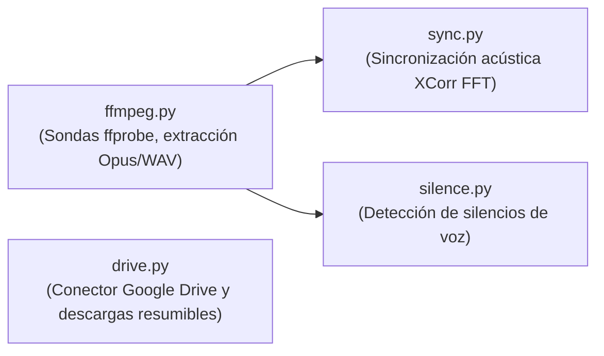

# Procesamiento Multimedia (`clipsmedia`)

> [!abstract] En pocas palabras
> Es la capa de comunicación directa con FFmpeg y el sistema de archivos. Se encarga de inspeccionar las pistas de video, extraer audio ultraliviano en formato Opus para la IA y calcular la sincronización milimétrica entre la cámara y el juego mediante análisis de ondas sonoras.

---

## 🎯 Módulos principales (`packages/media/clipsmedia/`)



---

## 🔍 1. Sondas y Extracción de Audio (`ffmpeg.py`)

- **`probe(path)`**: Ejecuta `ffprobe` en modo JSON para extraer duración exacta, resolución ($W \times H$), tasa de cuadros (fps), códec de video y listado de todas las pistas de audio disponibles.
- **Extracción de Opus ($16\text{ kHz}$ mono)**:
  Comprime el audio del micrófono de la cámara a una tasa constante de $24\text{ kbps}$:
  ```bash
  ffmpeg -hide_banner -y -i camara.mp4 -vn -c:a libopus -b:a 24k -ar 16000 -ac 1 camara.opus
  ```
  Esto reduce 1 hora de video de 10 GB a un archivo ligero de tan solo **~7 MB**, apto para ser transmitido por API en 1 segundo.
- **División en tramos (*Chunks*) de 10 minutos**:
  Para respetar los límites de tamaño de las APIs y posibilitar la transcripción paralela, el audio se divide en bloques de 600 segundos (`AudioChunk`), calculando el SHA-256 de cada fragmento para caché idempotente.

---

## 🔄 2. Sincronización Acústica ([[Glosario#XCorr FFT|XCorr FFT]]) (`sync.py`)

Cuando un streamer graba con dos aplicaciones o dispositivos separados, suele existir una diferencia temporal (*offset*) de varios segundos entre el juego y la cámara.

FarmClips resuelve esto de forma matemática sin requerir marcas manuales:
1. Extrae pistas WAV mono a $16\text{ kHz}$ de ambos archivos.
2. Aplica **Correlación Cruzada en el Dominio de la Frecuencia** mediante la Transformada Rápida de Fourier (FFT):
   $$R_{xy}(\tau) = \mathcal{F}^{-1} \left\{ \mathcal{F}\{x\} \cdot \mathcal{F}\{y\}^* \right\}$$
3. El pico máximo de la función $R_{xy}(\tau)$ determina el desplazamiento temporal exacto (`shift_sec`) y el factor de escala de reloj (`scale`).
4. La relación temporal universal queda formalizada en el objeto `SyncResult`:
   $$\text{tiempo\_cámara} = \text{tiempo\_master} \times \text{scale} + \text{shift\_sec}$$

---

## 🤫 3. Detección de Silencios (`silence.py`)

Aplica el filtro `silencedetect` de FFmpeg con umbral acústico de $-38\text{ dB}$ y duración mínima de $0.5\text{ s}$. 
Esto genera una lista de intervalos `[SilenceSpan]` que el director utiliza para saber qué momentos pueden cortarse limpiamente mediante **[[Glosario#Jump Cut|Jump Cuts]]** sin cortar la voz del creador.

---

## ☁️ 4. Conectores de Google Drive y Explorador (`drive.py`)

Implementa el protocolo `DriveConnector` con tres adaptadores intercambiables en caliente:
- **`LocalFolderDriveConnector`**: Opera sobre el directorio local (`data/drive_mirror`), manteniendo subcarpetas `Entradas/` y `Salidas/`.
- **`GoogleDriveServiceAccountConnector`**: Autenticación JWT RSA-256 sin dependencias pesadas y descargas/subidas resumibles en streaming hacia Google Drive API v3.
- **`GoogleDriveOAuthConnector`**: Flujo OAuth 2.0 (`authorization_code` + renovación automática con `refresh_token` persistido en `data/drive_oauth_token.json`).
- **Exploración y emparejamiento automático (`browse_folder` y `_pick_gameplay_and_camera`)**: Lista subcarpetas y videos con migas de pan (*breadcrumbs*), infiere el rol de cada archivo (`gameplay` o `camera`) priorizando palabras clave explícitas y sugiere el par óptimo para crear sesiones en un clic.

---

## 🔗 Relacionado
- [[Arquitectura general]]
- [[FastAPI y Orquestador]]
- [[Tracking Facial en CPU]]
- [[Flujo 1 Ingesta y Sincronización]]