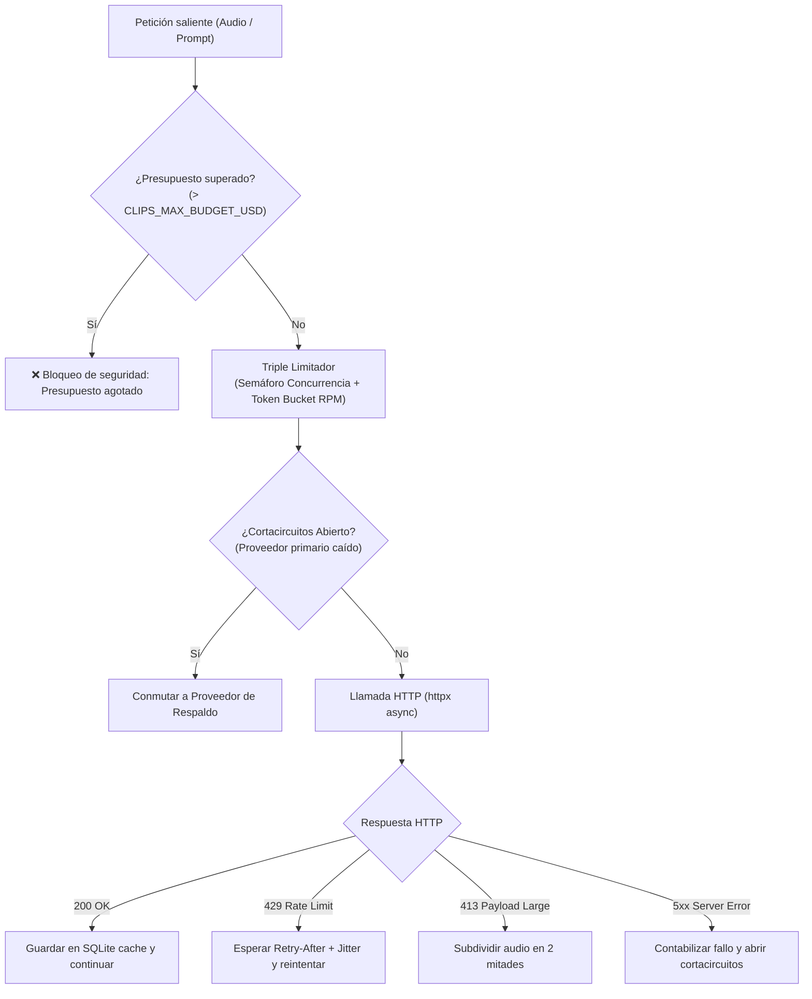

# Proveedores de IA y Resiliencia HTTP (`clipsproviders`)

> [!abstract] En pocas palabras
> Es la muralla defensiva y adaptativa que conecta FarmClips con los modelos de lenguaje y transcripción. Protege tu bolsillo impidiendo cobros inesperados y se asegura de que si un servicio externo cae o devuelve error, el sistema cambie de proveedor de respaldo automáticamente.

---

## 🛡️ Capas de Resiliencia HTTP (`clipsproviders/http/`)

---

## ⚙️ 1. Control de Presupuesto (*Budget Guard*)

- Cada llamada almacena en la tabla `api_calls` de SQLite: fecha, proveedor, modelo, unidades consumidas (segundos de audio o tokens de prompt/respuesta) y costo estimado en dólares estadounidenses ($USD$).
- Parámetro por defecto: `CLIPS_MAX_BUDGET_USD = 9.00`.
- El método `check_budget()` suma el costo total de la sesión actual; si la siguiente petición proyectada superaría el límite, lanza una excepción controlada impidiendo la llamada a internet y publicando un evento SSE de alerta al frontend.

---

## 🎙️ 2. Módulos de Transcripción ([[Glosario#STT|STT]]) y Filtro de Silencios

- **`deepgram.py`**:
  Utiliza el endpoint `https://api.deepgram.com/v1/listen` con el modelo `nova-3`. Envía el audio en formato binario directo en el cuerpo de la petición con cabecera `Content-Type: audio/opus`. Incorpora inyección de palabras clave dinámicas (**[[Glosario#Keyterms|Keyterms]]**) según el videojuego detectado.
- **`groq.py`**:
  Utiliza el endpoint compatible con OpenAI `https://api.groq.com/openai/v1/audio/transcriptions` con el modelo `whisper-large-v3-turbo`, enviando el audio como `multipart/form-data`.
- **Pre-filtrado VAD / Silencios (`ApiPool._chunk_speech_ratio`)**:
  Antes de facturar un fragmento de audio en la API externa, calcula la proporción de voz activa frente a los silencios detectados (`SilenceSpan`). Si un tramo ($\ge 10\text{ s}$) supera el $97\%$ de silencio (streamer ausente o pantalla de espera), se omite la llamada HTTP con costo \$0.00 y se almacena en caché como tramo vacío.
- **Envío solo de voz (`clipsmedia.silence.write_speech_only_opus`, `CLIPS_STT_SPEECH_ONLY`)**:
  En los tramos que sí se transcriben, se recortan los silencios de $\ge 2\text{ s}$ (dejando $0.35\text{ s}$ de margen a cada lado) y se sube un Opus solo con voz, unido con `atrim` + `concat` a precisión de muestra. Las palabras vuelven a su tiempo original con el mapa de segmentos (`remap_packed_words`); una palabra nunca queda estirada sobre un silencio quitado y el mapa se guarda junto a la respuesta cruda (`stt_<hash>.packmap.json`). Solo se usa si ahorra $\ge 20\text{ s}$ y $\ge 15\%$ del tramo; si el recorte falla, se envía el tramo original. Los adaptadores de *fixtures* (`accepts_speech_only_audio = False`) reciben siempre el audio original.

  > [!example] Ejemplo
  > Un tramo de 10 min con 3 min de partida en silencio se factura como $\approx 7\text{ min}$ de audio. Las pausas cortas entre frases se conservan, así que el texto y los tiempos que llegan a la curación son los mismos.
- **`fixture.py`**:
  Carga respuestas grabadas en disco sin conexión a internet para pruebas automáticas (`pytest`).

---

## 🧠 3. Módulos de Selección ([[Glosario#LLM|LLM]]) y Optimización de Tokens

- **`gemini.py` y `openai_compat.py`**:
  Envían la línea de tiempo compacta a `gemini-3.5-flash-lite` o proveedores compatibles con OpenAI (`gpt-6-luna`, Ollama, vLLM) con validación estricta de JSON Schema.
- **Costo real de Gemini (tokens de razonamiento)**:
  Google cobra el razonamiento del modelo a tarifa de salida pero lo reporta aparte (`thoughtsTokenCount`). `gemini.py` lo suma a `output_tokens`, así el gasto registrado y el tope `CLIPS_MAX_BUDGET_USD` reflejan lo que realmente se factura. En OpenAI-compatible no hace falta: `completion_tokens` ya incluye el razonamiento.
- **Prefijo Invariante para *Prompt Caching***:
  `CURATION_SYSTEM_PROMPT` (versión `v2.1`) mantiene las directivas estáticas al inicio y ubica los parámetros dinámicos de la sesión en la última línea, maximizando los aciertos automáticos de caché de prefijo en Gemini y OpenAI con descuentos de hasta el $75\%$.
- **Directivas Cinematográficas de Alto Impacto y Bajo Consumo**:
  El prompt guía al modelo a formular títulos con gancho en presente activo, cortar en seco tras la reacción cómica/triunfal e identificar la palabra exacta del clímax (`zoom_word`) y su foco (`zoom_focus`: `"face"`, `"game"`, `"split"`). Añade únicamente $\sim 3$ tokens a la respuesta de la IA sin sobrecostes.
- **Reintento Pydantic sin Duplicación de Transcripción (`repair_prompt`)**:
  Si el modelo falla la validación de esquema en el primer intento, el segundo llamado envía el borrador JSON previo (`first.raw_text`) y trunca la transcripción de referencia a un extracto compacto ($\le 1200$ caracteres), ahorrando más del $85\%$ de los tokens de entrada en reintentos.
- **Esquema de Salida Minificado y Fallback Local en CPU**:
  Solo exige como campos obligatorios `start_id`, `end_id`, `overlay_title` y `score`. Metadatos decorativos y de zoom son opcionales con inferencia automática en CPU local (`clipscore/selection/resolver.py`) si la IA los omite.

---

## 🔗 Relacionado
- [[Arquitectura general]]
- [[FastAPI y Orquestador]]
- [[Pools de Trabajo]]
- [[Runbook · Falla de API o Presupuesto Agotado]]
- [[ADR-005 Caché Idempotente y Límite de Presupuesto]]