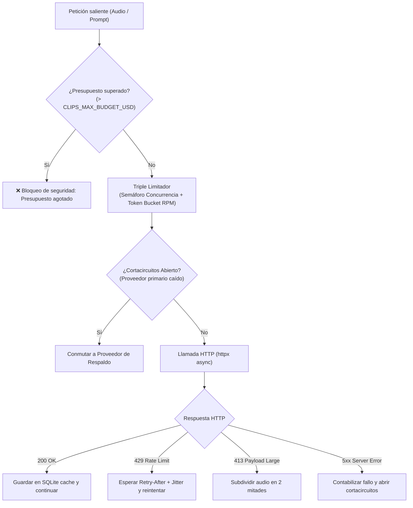

# Proveedores de IA y Resiliencia HTTP (`clipsproviders`)

> [!abstract] En pocas palabras
> Es la muralla defensiva y adaptativa que conecta FarmClips con los modelos de lenguaje y transcripción. Protege tu bolsillo impidiendo cobros inesperados y se asegura de que si un servicio externo cae o devuelve error, el sistema cambie de proveedor de respaldo automáticamente.

---

## 🛡️ Capas de Resiliencia HTTP (`clipsproviders/http/`)

---

## ⚙️ 1. Control de Presupuesto (*Budget Guard*)

- Cada llamada almacena en la tabla `api_calls` de SQLite: fecha, proveedor, modelo, unidades consumidas (segundos de audio o tokens de prompt/respuesta) y costo estimado en dólares estadounidenses ($USD$).
- Parámetro por defecto: `CLIPS_MAX_BUDGET_USD = 9.00`.
- El método `check_budget()` suma el costo total de la sesión actual; si la siguiente petición proyectada superaría el límite, lanza una excepción controlada impidiendo la llamada a internet y publicando un evento SSE de alerta al frontend.

---

## 🎙️ 2. Módulos de Transcripción ([[Glosario#STT|STT]]) y Filtro de Silencios

- **`deepgram.py`**:
  Utiliza el endpoint `https://api.deepgram.com/v1/listen` con el modelo `nova-3`. Envía el audio en formato binario directo en el cuerpo de la petición con cabecera `Content-Type: audio/opus`. Incorpora inyección de palabras clave dinámicas (**[[Glosario#Keyterms|Keyterms]]**) según el videojuego detectado.
- **`groq.py`**:
  Utiliza el endpoint compatible con OpenAI `https://api.groq.com/openai/v1/audio/transcriptions` con el modelo `whisper-large-v3-turbo`, enviando el audio como `multipart/form-data`.
- **Pre-filtrado VAD / Silencios (`ApiPool._chunk_speech_ratio`)**:
  Antes de facturar un fragmento de audio en la API externa, calcula la proporción de voz activa frente a los silencios detectados (`SilenceSpan`). Si un tramo ($\ge 10\text{ s}$) supera el $97\%$ de silencio (streamer ausente o pantalla de espera), se omite la llamada HTTP con costo \$0.00 y se almacena en caché como tramo vacío.
- **`fixture.py`**:
  Carga respuestas grabadas en disco sin conexión a internet para pruebas automáticas (`pytest`).

---

## 🧠 3. Módulos de Selección ([[Glosario#LLM|LLM]]) y Optimización de Tokens

- **`gemini.py` y `openai_compat.py`**:
  Envían la línea de tiempo compacta a `gemini-3.5-flash-lite` o proveedores compatibles con OpenAI (`gpt-6-luna`, Ollama, vLLM) con validación estricta de JSON Schema.
- **Prefijo Invariante para *Prompt Caching***:
  `CURATION_SYSTEM_PROMPT` mantiene las instrucciones estáticas al inicio y ubica los parámetros dinámicos de la sesión en la última línea, maximizando los aciertos automáticos de caché de prefijo en Gemini, OpenAI y Groq.
- **Reintento Pydantic sin Duplicación de Transcripción (`repair_prompt`)**:
  Si el modelo falla la validación de esquema en el primer intento, el segundo llamado envía el borrador JSON previo (`first.raw_text`) y trunca la transcripción de referencia a un extracto compacto ($\le 1200$ caracteres), ahorrando más del $85\%$ de los tokens de entrada en reintentos.
- **Esquema de Salida Minificado**:
  Solo exige como campos obligatorios `start_id`, `end_id`, `overlay_title` y `score`, permitiendo omitir metadatos decorativos que se infieren en CPU local sin costo de tokens.

---

## 🔗 Relacionado
- [[Arquitectura general]]
- [[FastAPI y Orquestador]]
- [[Pools de Trabajo]]
- [[Runbook · Falla de API o Presupuesto Agotado]]
- [[ADR-005 Caché Idempotente y Límite de Presupuesto]]