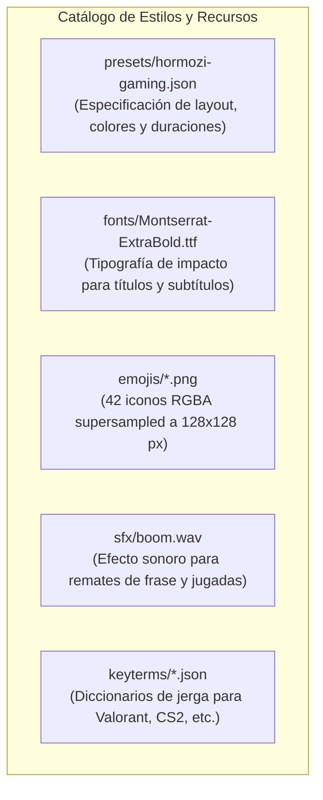

# Sistema de Estilos y Presets (`clipsstyles`)

> [!abstract] En pocas palabras
> Es el catálogo de identidad visual y sonora de FarmClips. Contiene la tipografía Montserrat ExtraBold, el preset de diseño Hormozi Gaming, 42 emojis en alta resolución, efectos de sonido de impacto y diccionarios de palabras clave por videojuego para mejorar la transcripción.

---

## 🎨 Componentes del paquete (`packages/styles/clipsstyles/`)

---

## 📐 1. Preset `hormozi-gaming.json`

Define todas las constantes de diseño para la relación de aspecto vertical:
- **Formato**: Resolución de salida $1080 \times 1920$ a 60 fps.
- **Duraciones**: Rango permitido entre 20 y 60 segundos por clip.
- **Disposición de cámaras (*Layout*)**:
  - Proporción de cámara superior: `camera_ratio: 0.40` (40 % superior para cámara, 60 % inferior para gameplay).
  - Borde de división (*Seam*): Línea divisoria de 4 píxeles en color negro sólido (`#000000`).
- **Subtítulos Hormozi**:
  - Fuente: `Montserrat ExtraBold`, tamaño base 80 px.
  - Color base: Blanco (`#FFFFFF`) con contorno negro reforzado de 8 px y sombra suave de 3 px.
  - Palabra activa: Amarillo vibrante (`#FFD400`) con salto de escala del 115 % (`pop_scale_pct`).
  - Palabra destacada: Verde eléctrico (`#39FF14`) con 110 % de escala.
- **Título superior**:
  - Tamaño: 74 px con contorno negro de 7 px para máxima legibilidad en la línea divisoria (*seam*).

---

## 👑 2. Catálogo de 42 Emojis Supersampled

Para evitar la apariencia pixelada de los emojis nativos del sistema operativo, FarmClips incluye 42 archivos PNG prerenderizados en resolución de $128 \times 128$ píxeles con canal alfa transparente (RGBA):
- Fuego (`🔥` - `1f525.png`) para momentos épicos y rachas de bajas.
- Rostro gritando de miedo (`😱` - `1f631.png`) para sorpresas o sustos.
- Corona (`👑` - `1f451.png`) para victorias y clutch 1v1.
- Diana / Tiro al blanco (`🎯` - `1f3af.png`) para disparos a la cabeza (*headshots*).

---

## 🎯 3. Diccionarios de Jerga (*Keyterms*)

Ubicados en `clipsstyles/keyterms/` (p. ej. `valorant.json`):
- Contiene términos técnicos de cada juego: nombres de agentes (*Jett, Reyna, Sova*), habilidades (*resurrect, flash, smoke*), armas (*Vandal, Phantom, Operator*) y jerga (*clutch, ace, spike, flankear*).
- La función `resolve_game_keyterms()` analiza el título de la sesión y, si detecta el videojuego, inyecta automáticamente estos términos en el parámetro `keywords` de Deepgram para asegurar una transcripción impecable.

---

## 🔗 Relacionado
- [[Contrato EditPlan v2]]
- [[Motor de Renderizado y Subtítulos]]
- [[Cómo añadir un nuevo Preset de Estilo]]