# Tracking Facial en CPU (`clipstracking`)

> [!abstract] En pocas palabras
> Es el camarógrafo virtual de FarmClips. Detecta la cara del streamer para recortar el video y mantenerlo siempre centrado en el tercio superior del Short, funcionando directamente en el procesador convencional (CPU) sin requerir tarjeta gráfica pesada.

---

## 🎯 Principio de economía de recursos

La mayoría de los sistemas comerciales de recorte automático procesan el video completo de 2 horas con redes neuronales pesadas, tardando horas y saturando la tarjeta gráfica.

FarmClips aplica una estrategia de **cómputo diferido y acotado**:
1. **Solo se rastrea lo que se va a usar**: El detector facial no toca el video de 2 horas. Espera a que el LLM elija los 5 o 6 clips finales y **únicamente procesa esos 30 a 60 segundos de metraje** (con 2 segundos de margen de seguridad).
2. **Entrada ligera por tubería (*Pipe*)**: Extrae fotogramas a baja resolución ($640\text{ px}$) y a solo 15 fotogramas por segundo directamente en memoria RAM mediante `pipe:1` de FFmpeg, evitando escribir imágenes temporales en disco.

```mermaid
flowchart LR
    CAM["camara.mp4 (1080p, 60 fps)"] -->|Pipe FFmpeg: 15 fps, 640 px| MP["MediaPipe Face Detector<br/>(blaze_face_short_range.tflite)"]
    MP --> INTERP["Interpolación de huecos<br/>(<1s lineal / >1s centro)"]
    INTERP --> ONE_EURO["Filtro One Euro<br/>(Elimina temblor sin lag)"]
    ONE_EURO --> DEADBAND["Deadband<br/>(Ignora movimientos < 8%)"]
    DEADBAND --> RDP_ALG["Simplificación RDP<br/>(Ramer-Douglas-Peucker)"]
    RDP_ALG --> PARQ["face.parquet<br/>(Keyframes de cámara)"]
```

---

## 🔬 Algoritmos matemáticos del pipeline facial

### 1. Interpolación de oclusiones y pérdidas temporales
Si el streamer gira la cabeza, se tapa la cara con la mano o bebe agua y el detector pierde el rostro:
- **Pérdidas cortas ($< 1.0\text{ s}$)**: El sistema realiza una interpolación lineal entre la última posición conocida y la reaparición del rostro, manteniendo el encuadre estable.
- **Pérdidas largas ($> 1.0\text{ s}$)**: Si el streamer se levanta de la silla o sale de plano, el encuadre regresa suavemente hacia el centro neutro predeterminado ($\text{cx}=0.5, \text{cy}=0.45$).

### 2. Filtro adaptativo One Euro
El **[[Glosario#One Euro Filter|One Euro Filter]]** resuelve el compromiso entre estabilidad y retardo (*latency*):
- A velocidades bajas (streamer quieto hablando), aumenta la constante de tiempo eliminando el temblor (*jitter*) de los píxeles.
- A velocidades altas (reacción enérgica o salto), reduce la constante de tiempo para seguir el rostro de inmediato sin retraso visual.

### 3. Zona muerta (*Deadband*)
Aplica un umbral de tolerancia del 8 % alrededor del centro. Si la cabeza solo se inclina ligeramente o respira, la cámara virtual permanece estática.

### 4. Simplificación Ramer-Douglas-Peucker (RDP)
A partir de cientos de fotogramas continuos, el algoritmo **[[Glosario#RDP|RDP]]** descarta las coordenadas intermedias redundantes, conservando únicamente los vértices críticos donde la trayectoria cambia de dirección. Esto reduce la curva a una lista compacta de `CropKeyframe` para el **[[Glosario#EditPlan|EditPlan]]**.

---

## 🔗 Relacionado
- [[Arquitectura general]]
- [[Pools de Trabajo]]
- [[Contrato EditPlan v2]]
- [[Motor de Renderizado y Subtítulos]]
- [[ADR-003 Tracking Facial por Clip en CPU]]