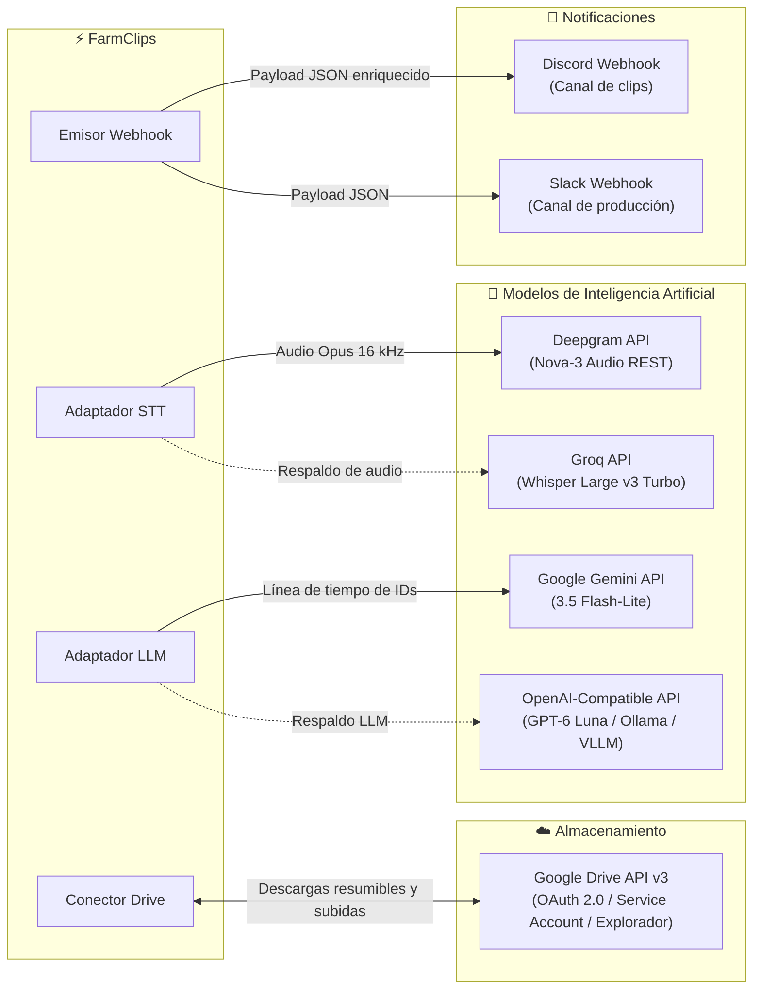

# Integraciones y servicios externos

> [!abstract] En pocas palabras
> Describe las conexiones de FarmClips con servicios de almacenamiento en la nube (Google Drive), APIs de transcripción y lenguaje (Deepgram, Groq, Gemini, OpenAI) y canales de notificación automática (Discord y Slack).

---

## 🗺️ Mapa de integraciones del sistema



---

## ☁️ 1. Google Drive (Triple modalidad + Explorador Interactivo)

FarmClips puede operar con carpetas locales sincronizadas, con una cuenta personal de Google mediante OAuth 2.0 o con una cuenta de servicio corporativa de Google Cloud, e incluye un explorador visual de carpetas y videos en `/sessions`:

| Característica | Modalidad Local (`local`) | Modalidad OAuth 2.0 (`oauth`) | Modalidad Cuenta de Servicio (`service_account`) |
|---|---|---|---|
| **Mecanismo** | Observador y explorador de carpetas en disco duro | Google Drive API v3 con autorización de usuario | Google Drive API v3 servidor a servidor |
| **Credenciales** | Ninguna (usa el espejo local en disco) | `CLIPS_DRIVE_CLIENT_ID` + `CLIPS_DRIVE_CLIENT_SECRET` y `refresh_token` en `data/drive_oauth_token.json` | Archivo `service_account.json` firmado con RSA-256 |
| **Explorador interactivo** | Navegación de subcarpetas (`Entradas/`), migas de pan y filtro | Navegación en tiempo real de unidades y carpetas en la nube (`GET /drive/files`) | Navegación de carpetas compartidas con la cuenta de servicio |
| **Auto-detección de par** | Empareja `gameplay` y `cámara` por nombre o bitrate | Sugiere par en 1 clic (`detected_pair`) y descarga en `ApiPool` (`POST /drive/sessions`) | Sugiere par en 1 clic y descarga resumible por bloques |
| **Estructura** | `Entradas/<grabación>/` y `Salidas/<grabación>/` | `drive_root_folder_id` (o `root` de «Mi unidad») | `drive_root_folder_id` compartido con el correo del bot |

---

## 🎙️ 2. Proveedores de Transcripción ([[Glosario#STT|STT]])

1. **Deepgram Nova-3 (Principal)**:
   - Envío de audio comprimido en Opus mono $16\text{ kHz}$.
   - Parámetros: `punctuate=true`, `smart_format=true`, `utterances=true`, `keywords=<keyterms>`, `language=es`.
   - Latencia media: ~3 segundos por fragmento de 10 minutos.
2. **Groq Whisper Large v3 Turbo (Respaldo)**:
   - Transcripción acelerada por hardware LPU.
   - Entra en acción si Deepgram devuelve error 5xx, agota cuota o ante fallo de conectividad.
3. **Fixture local**:
   - Modo de pruebas para desarrolladores (`tests/fixtures/api/deepgram_es.json`) que simula la respuesta sin consumir llamadas a internet.

---

## 🧠 3. Proveedores de Selección ([[Glosario#LLM|LLM]])

1. **Google Gemini 3.5 Flash-Lite (Principal)**:
   - Entrada: Texto plano compacto de la línea de tiempo con formato `[u0012] 00:03:12 (exc: 0.82) ¡Qué disparo increíble!`.
   - Salida estructurada: JSON Schema validado con lista de candidatos (`start_id`, `end_id`, `overlay_title`, `score`, `reason`).
2. **OpenAI Compatible (Respaldo / Local)**:
   - Compatible con endpoints estándar `https://api.openai.com/v1` o servidores locales como Ollama, LM Studio o vLLM.
   - Modelo por defecto: `gpt-6-luna`.

---

## 📢 4. Notificaciones por [[Glosario#Webhook|Webhook]]

Al concluir el renderizado de los clips en 1080p, el sistema despacha una petición HTTP POST a la URL configurada en `.env` (`CLIPS_WEBHOOK_URL`).

> [!example] Formato enriquecido para Discord
> ```json
> {
>   "username": "FarmClips Bot",
>   "embeds": [
>     {
>       "title": "🎬 5 nuevos Shorts listos para publicar",
>       "description": "Sesión: **Partida Torneo Valorant**\nCalificación máxima: **94/100**",
>       "color": 39423,
>       "fields": [
>         {"name": "Clip #1", "value": "[Descargar 1080p](http://127.0.0.1:3040/editor/clip_01)", "inline": true},
>         {"name": "Duración", "value": "42 segundos", "inline": true}
>       ]
>     }
>   ]
> }
> ```

---

## 🎬 5. FilmCraft NLE & Copiloto MCP

FarmClips se integra nativamente con el editor no lineal de escritorio **FilmCraft** y clientes MCP (Claude Desktop, Antigravity, Cursor):

1. **Exportación determinista de proyectos:**
   - Transforma el `EditPlan v2` a un proyecto `.fcproj` (`schema_version: 17`) con pistas multicapa (`V1 Gameplay`, `V2 Cámara`, `V3 Overlays`, `A1 Mic`, `A2 Juego`, `A3 SFX`), base de tiempo en ticks racionales (`254,016,000,000` ticks/seg) y marcadores para cada frase.
2. **Control Loopback y Lanzador:**
   - La API de FarmClips lanza FilmCraft con `--control 9876` o reutiliza la instancia abierta comunicándose vía `filmcraft-cli --bridge 127.0.0.1:9876`.
3. **Servidor MCP stdio (`farmclips-mcp`):**
   - Expone 9 herramientas semánticas para que Claude entienda el contexto de la grabación (transcripción con marcas de tiempo, metadatos y cortes) y opere sobre el proyecto abierto en FilmCraft.

---

## 🔗 Relacionado
- [[Arquitectura general]]
- [[Proveedores de IA y Resiliencia]]
- [[Cómo configurar Proveedores de IA]]
- [[Runbook · Falla de API o Presupuesto Agotado]]