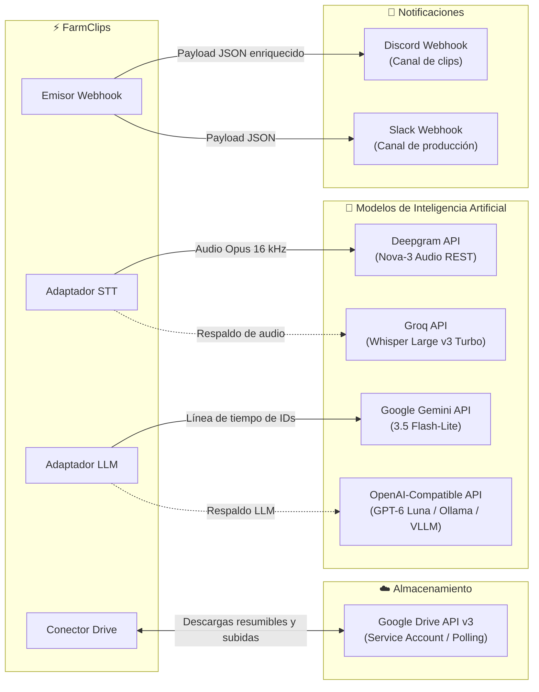

# Integraciones y servicios externos

> [!abstract] En pocas palabras
> Describe las conexiones de FarmClips con servicios de almacenamiento en la nube (Google Drive), APIs de transcripción y lenguaje (Deepgram, Groq, Gemini, OpenAI) y canales de notificación automática (Discord y Slack).

---

## 🗺️ Mapa de integraciones del sistema



---

## ☁️ 1. Google Drive (Doble modalidad)

FarmClips puede operar tanto con carpetas locales vinculadas a la app de escritorio de Google Drive como mediante una cuenta de servicio formal de Google Cloud:

| Característica | Modalidad Local (`local_folder`) | Modalidad Nube (`service_account`) |
|---|---|---|
| **Mecanismo** | Observador de carpetas en disco duro | Llamadas directas a Google Drive API v3 |
| **Credenciales** | Ninguna (usa el cliente de Google Drive) | Archivo `service_account.json` |
| **Resilencia** | Exige 2 chequeos consecutivos sin cambio de tamaño | Descarga y subida resumible en fragmentos (chunks) |
| **Estructura** | `Entradas/<grabación>/` y `Salidas/<grabación>/` | ID de carpeta raíz en Drive (`drive_root_folder_id`) |

---

## 🎙️ 2. Proveedores de Transcripción ([[Glosario#STT|STT]])

1. **Deepgram Nova-3 (Principal)**:
   - Envío de audio comprimido en Opus mono $16\text{ kHz}$.
   - Parámetros: `punctuate=true`, `smart_format=true`, `utterances=true`, `keywords=<keyterms>`, `language=es`.
   - Latencia media: ~3 segundos por fragmento de 10 minutos.
2. **Groq Whisper Large v3 Turbo (Respaldo)**:
   - Transcripción acelerada por hardware LPU.
   - Entra en acción si Deepgram devuelve error 5xx, agota cuota o ante fallo de conectividad.
3. **Fixture local**:
   - Modo de pruebas para desarrolladores (`tests/fixtures/api/deepgram_es.json`) que simula la respuesta sin consumir llamadas a internet.

---

## 🧠 3. Proveedores de Selección ([[Glosario#LLM|LLM]])

1. **Google Gemini 3.5 Flash-Lite (Principal)**:
   - Entrada: Texto plano compacto de la línea de tiempo con formato `[u0012] 00:03:12 (exc: 0.82) ¡Qué disparo increíble!`.
   - Salida estructurada: JSON Schema validado con lista de candidatos (`start_id`, `end_id`, `overlay_title`, `score`, `reason`).
2. **OpenAI Compatible (Respaldo / Local)**:
   - Compatible con endpoints estándar `https://api.openai.com/v1` o servidores locales como Ollama, LM Studio o vLLM.
   - Modelo por defecto: `gpt-6-luna`.

---

## 📢 4. Notificaciones por [[Glosario#Webhook|Webhook]]

Al concluir el renderizado de los clips en 1080p, el sistema despacha una petición HTTP POST a la URL configurada en `.env` (`CLIPS_WEBHOOK_URL`).

> [!example] Formato enriquecido para Discord
> ```json
> {
>   "username": "FarmClips Bot",
>   "embeds": [
>     {
>       "title": "🎬 5 nuevos Shorts listos para publicar",
>       "description": "Sesión: **Partida Torneo Valorant**\nCalificación máxima: **94/100**",
>       "color": 39423,
>       "fields": [
>         {"name": "Clip #1", "value": "[Descargar 1080p](http://127.0.0.1:3040/editor/clip_01)", "inline": true},
>         {"name": "Duración", "value": "42 segundos", "inline": true}
>       ]
>     }
>   ]
> }
> ```

---

## 🔗 Relacionado
- [[Arquitectura general]]
- [[Proveedores de IA y Resiliencia]]
- [[Cómo configurar Proveedores de IA]]
- [[Runbook · Falla de API o Presupuesto Agotado]]