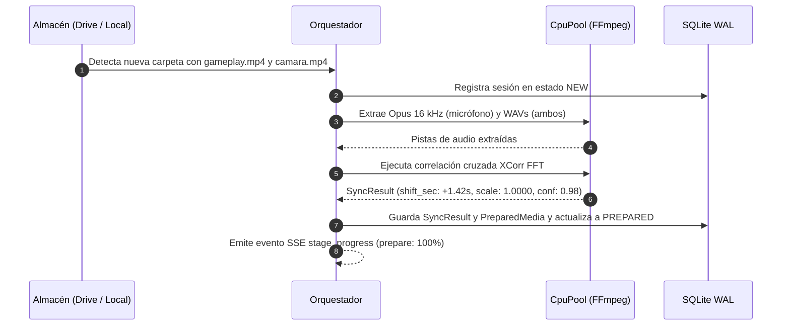

# Flujo 1 · Ingesta de medios y sincronización acústica

> [!abstract] En pocas palabras
> Primer paso del pipeline: detecta los dos archivos de video (`gameplay` y `cámara`), extrae las pistas de audio livianas y calcula con precisión matemática el desfase en milisegundos entre ambas fuentes para que la reacción de la cara coincida exactamente con la jugada.

---

## 🗺️ Diagrama del proceso

---

## 🧭 Paso a paso detallado

### Paso 1: Detección automática o selección interactiva desde Google Drive
FarmClips ofrece dos vías complementarias para ingresar grabaciones:
1. **Explorador interactivo («Desde Drive» en `/sessions`)**: El creador navega visualmente sus carpetas de Google Drive (`oauth`, `service_account` o `local`) mediante `GET /drive/files`, utiliza la auto-detección en 1 clic de `gameplay` + `cámara` (o elige manualmente cada archivo) y dispara `POST /drive/sessions`. El `ApiPool` descarga ambos videos de forma concurrente y resumible mientras emite eventos SSE de progreso (`stage_progress: download`).
2. **Sondeo automático de estabilidad**: El observador de carpetas detecta nuevas grabaciones en `Entradas/`. Para evitar procesar archivos que aún se están copiando o subiendo, el sistema exige dos verificaciones consecutivas separadas por 5 segundos donde el tamaño en bytes del archivo permanezca idéntico.

### Paso 2: Extracción acústica
El `CpuPool` lanza procesos de FFmpeg para extraer:
- `camera_opus_path`: Audio del micrófono codificado en Opus mono a $16\text{ kHz}$ ($24\text{ kbps}$), segmentado en tramos de 10 minutos para la API.
- `camera_wav16k` y `gameplay_wav16k`: Pistas sin comprimir necesarias para el análisis espectral.

### Paso 3: Alineación matemática por [[Glosario#XCorr FFT|XCorr FFT]]
Calcula el producto espectral cruzado de las pistas de audio para determinar el retraso exacto:
- `shift_sec`: Segundos que la cámara está adelantada o retrasada respecto al juego.
- `confidence`: Nivel de certidumbre matemática (valores superiores a 0.85 indican alineación perfecta).

> [!example] Ejemplo real
> En una grabación donde el streamer abrió OBS primero y la cámara web empezó a grabar 1.42 segundos después, el algoritmo detecta automáticamente `shift_sec = 1.420`. Cualquier segundo $T$ del gameplay se proyecta a la cámara como $T \times 1.0 + 1.420$.

---

## 🔗 Relacionado
- [[Flujo 2 Transcripción y Señales]]
- [[Procesamiento Multimedia]]
- [[Runbook · Desincronización de Audio o Video]]