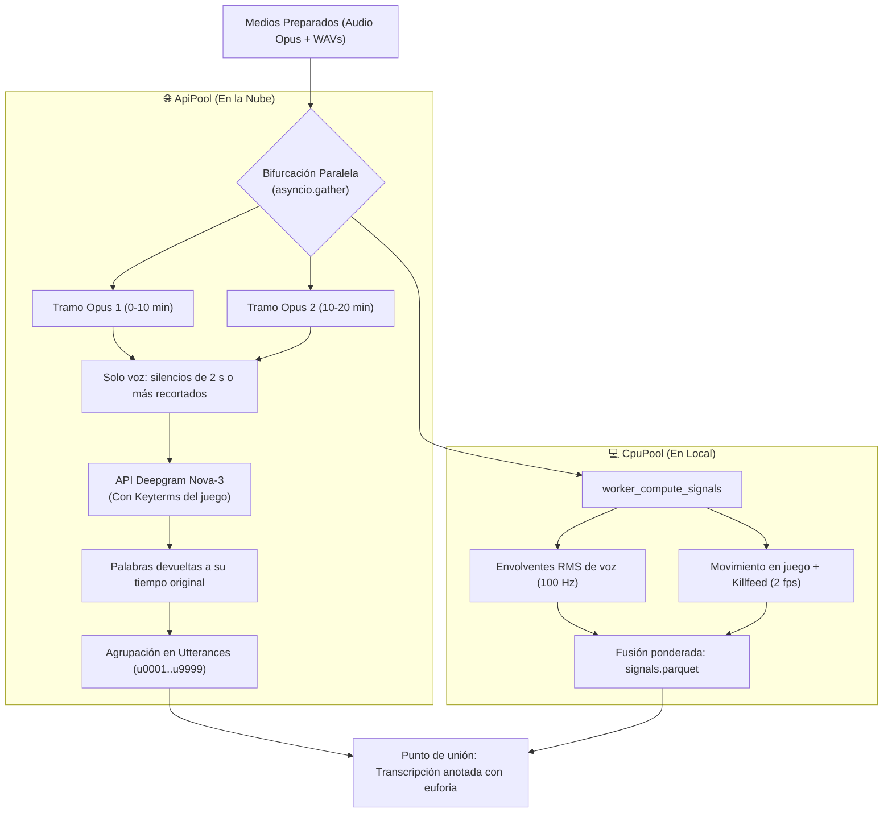

# Flujo 2 · Transcripción por API y análisis de señales en paralelo

> [!abstract] En pocas palabras
> Segundo paso del pipeline: mientras la nube transcribe la voz del streamer a toda velocidad dividida en fragmentos, la computadora local analiza frame a frame las curvas de gritos, disparos y movimiento del juego, uniendo ambos mundos en un mapa temporal completo.

---

## 🗺️ Diagrama del proceso concurrente



---

## 🧭 Paso a paso detallado

### Paso 1: Transcripción concurrente de tramos Opus
El `ApiPool` toma los fragmentos de 10 minutos generados en el Flujo 1 y los envía en paralelo a Deepgram Nova-3. Cada llamada inyecta la lista de **[[Glosario#Keyterms|Keyterms]]** asociada al videojuego para no confundir nombres propios ni jerga (p. ej. *Ace, Spike, Defuse*).

Antes de subir cada tramo se quitan los silencios largos (jugadas sin hablar, pausas AFK): la API cobra por segundo de audio y el silencio no aporta palabras. Al volver, cada palabra se coloca de nuevo en su segundo exacto del video, por lo que el resto del pipeline no nota la diferencia.

> [!info]- 🔧 Detalle técnico
> `ApiPool.transcribe_chunk_cached` llama a `write_speech_only_opus` (umbral $2\text{ s}$, margen $0.35\text{ s}$, mínimo $20\text{ s}$ y $15\%$ de ahorro) y remapea con `remap_packed_words`. Se desactiva con `CLIPS_STT_SPEECH_ONLY=false`.

### Paso 2: Agrupación en frases lingüísticas ([[Glosario#Utterance|Utterances]])
Al recibir las palabras individuales, el algoritmo `group_words_into_utterances()` agrupa el texto basándose en pausas fonéticas ($> 0.4\text{ s}$) y puntuación sintáctica, generando identificadores legibles (`u0001`, `u0002`...).

### Paso 3: Análisis de señales en CPU (`signals.parquet`)
Simultáneamente, el `CpuPool` procesa los archivos WAV y el video a 2 fps:
1. Mide picos repentinos de voz (**[[Glosario#Ataque Acústico|ataques acústicos]]** y gritos de euforia).
2. Cuantifica el flujo de movimiento en la pantalla del juego.
3. Evalúa la actividad de la zona de eliminaciones (*Killfeed*).
4. Genera el índice de excitación compuesto ($\text{excitement} \in [0.0, 1.0]$).

> [!example] Salida resultante de la unión
> ```text
> [u0034] 00:02:45 (exc: 0.91) ¡Me están disparando tres, cúbreme!
> [u0035] 00:02:49 (exc: 0.96) ¡Eliminé al primero! ¡Queda uno!
> [u0036] 00:02:53 (exc: 0.98) ¡VAMOOOOOS, CLUTCH GANADO!
> ```

---

## 🔗 Relacionado
- [[Flujo 1 Ingesta y Sincronización]]
- [[Flujo 3 Curación con LLM]]
- [[Núcleo de Señales y Selección]]
- [[Proveedores de IA y Resiliencia]]