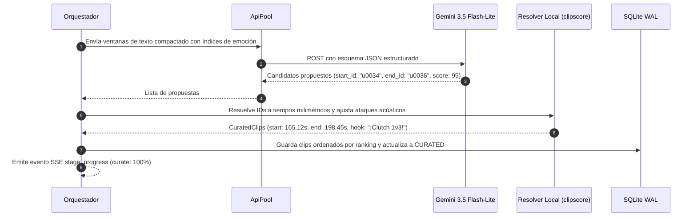

# Flujo 3 · Curación narrativa y selección con LLM

> [!abstract] En pocas palabras
> Tercer paso del pipeline: la inteligencia artificial actúa como un director de televisión, leyendo el resumen de la partida con sus picos de emoción para seleccionar las historias más entretenidas y sugerir títulos virales.

---

## 🗺️ Diagrama del proceso

---

## 🧭 Paso a paso detallado

### Paso 1: Partición en ventanas contextuales
Si la partida dura varias horas, el sistema divide la línea de tiempo en bloques contextuales de unos 20 a 30 minutos con solapamiento, asegurando que el LLM no pierda el hilo narrativo ni supere los límites de contexto eficiente.

### Paso 2: Selección por identificadores de frase, formatos editoriales y aprendizaje
El LLM recibe el sistema de instrucciones refinado (**Curation Prompt v2.1** + **Perfil editorial FarmClips 1.0**) con enfoque *token-frugal*:
- **Pistas acústicas y emocionales en el timeline**: Además de `>>> PICO`, el timeline compacto incluye marcas explícitas de silencio (`--- [PAUSA Xs] ---` para pausas $\ge 3\text{ s}$) y etiquetas `[REACCIÓN]` o `[ALTA REACCIÓN]` junto a las frases donde la reacción vocal del streamer es intensa.
- **Formato individual vs. recopilación (`editorial_format`)**:
  - `individual`: un acontecimiento autónomo con planteamiento, giro y remate.
  - `recopilacion`: dos o más tramos discontinuos en orden cronológico dentro de una ventana de `600 s` (`CLIPS_RELATED_WINDOW_SEC`), cada uno con `start_id`, `end_id`, `event`, `role`, `evidence_ids` y `relation`, más `initial_context` y `grouping_reason`.
- **Memoria editorial aprendida (`build_learned_editorial_guidance`)**: Cuando el creador valora clips en **Valorar clip** (`ClipReview`) o ajusta tramos y títulos en el editor (`edicion_estudio`), el sistema sintetiza preferencias por categoría, tendencias de recorte y hasta 3 *Golden Clips* aprobados para orientar las siguientes curaciones.
- **Títulos de alto CTR y dirección semántica (`zoom_word` y `zoom_focus`)**: Genera `overlay_title` (3 a 6 palabras), `post_title` en MAYÚSCULAS y la palabra clave del zoom de impacto (`zoom_word`) con su foco (`"face"`, `"game"` o `"split"`).
- **Solo responde con IDs de frase de inicio y fin** (`start_id` y `end_id`), sin alucinar marcas de tiempo decimales.

### Paso 3: Resolución, cola dinámica y suelo de exportación de 40 s
El módulo local `resolve_curated_clips()`:
1. Convierte los IDs en marcas de tiempo reales en segundos y valida que las recopilaciones contengan al menos dos acontecimientos distinguibles con `evidence_ids` verificables y cierre en `reaccion`, `climax` o `remate`.
2. **Cola dinámica guiada por decaimiento de audio (`compute_dynamic_tail_pad`)**: Extiende el margen final (hasta `1.65 s`) si el streamer sigue riendo o reaccionando tras la última palabra, o aplica un corte seco (`0.35 s`) si cae inmediatamente a silencio.
3. Calcula la puntuación combinada (`final_score = 0.70 * llm_score + 30.0 * sig_score`) y la puntuación editorial (`editorial_score = 0.85 * llm_score + 15.0 * sig_score`), eliminando duplicados o montajes redundantes.
4. **Suelo de exportación final (`40 s`)**: Los candidatos con duración montada $\ge 40\text{ s}$ pasan al flujo de entrega automática (verificado con `FFprobe`), mientras que los cortes más breves se conservan en estado `REVIEW_SHORT` para revisión o ampliación manual en el editor.

---

## 🔗 Relacionado
- [[Flujo 2 Transcripción y Señales]]
- [[Flujo 4 Tracking y Generación EditPlan]]
- [[Núcleo de Señales y Selección]]
- [[ADR-002 Selección por IDs de Frase en LLM]]