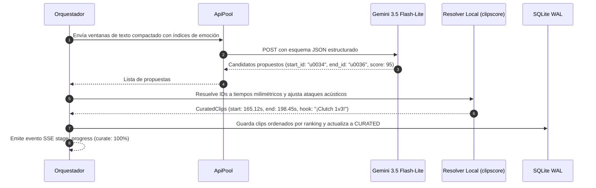

# Flujo 3 · Curación narrativa y selección con LLM

> [!abstract] En pocas palabras
> Tercer paso del pipeline: la inteligencia artificial actúa como un director de televisión, leyendo el resumen de la partida con sus picos de emoción para seleccionar las historias más entretenidas y sugerir títulos virales.

---

## 🗺️ Diagrama del proceso

---

## 🧭 Paso a paso detallado

### Paso 1: Partición en ventanas contextuales
Si la partida dura varias horas, el sistema divide la línea de tiempo en bloques contextuales de unos 20 a 30 minutos con solapamiento, asegurando que el LLM no pierda el hilo narrativo ni supere los límites de contexto eficiente.

### Paso 2: Selección por identificadores de frase
El LLM recibe instrucciones precisas de formato:
- Debe seleccionar historias autoconclusivas que tengan introducción, clímax y desenlace.
- La duración estimada debe situarse entre 20 y 60 segundos.
- **Solo debe responder con los IDs de frase de inicio y fin** (`start_id` y `end_id`), sin inventar números ni marcas de tiempo.
- Debe redactar un título magnético para el video (`overlay_title`) y una breve justificación de su elección (`reason`).

### Paso 3: Resolución y ajuste acústico milimétrico
El módulo local `resolve_curated_clips()`:
1. Convierte los IDs en marcas de tiempo reales en segundos.
2. Analiza los primeros 150 ms en la curva de envolvente a 100 Hz para atrasar el corte unos milisegundos y capturar el **[[Glosario#Ataque Acústico|ataque acústico]]** natural de la voz.
3. Calcula una puntuación combinada (**[[Glosario#Score|final_score]]**):
   $$\text{score\_final} = 0.60 \cdot \text{score\_llm} + 0.40 \cdot \text{score\_señal}$$
4. Registra los clips ordenados en la base de datos SQLite y selecciona los mejores candidatos (típicamente los 5 mejores por encima de 60 puntos) para renderizado automático.

---

## 🔗 Relacionado
- [[Flujo 2 Transcripción y Señales]]
- [[Flujo 4 Tracking y Generación EditPlan]]
- [[Núcleo de Señales y Selección]]
- [[ADR-002 Selección por IDs de Frase en LLM]]