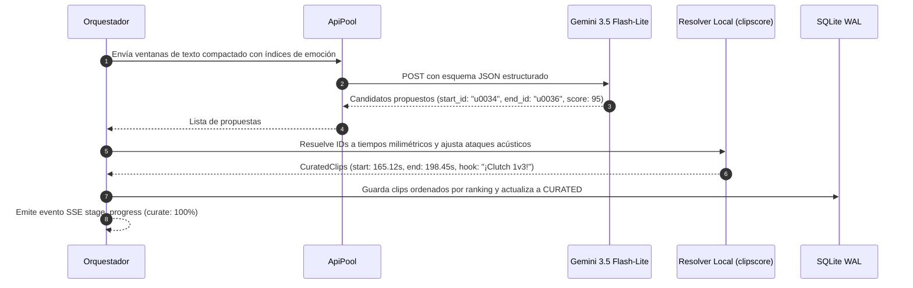

# Flujo 3 · Curación narrativa y selección con LLM

> [!abstract] En pocas palabras
> Tercer paso del pipeline: la inteligencia artificial actúa como un director de televisión, leyendo el resumen de la partida con sus picos de emoción para seleccionar las historias más entretenidas y sugerir títulos virales.

---

## 🗺️ Diagrama del proceso

---

## 🧭 Paso a paso detallado

### Paso 1: Partición en ventanas contextuales
Si la partida dura varias horas, el sistema divide la línea de tiempo en bloques contextuales de unos 20 a 30 minutos con solapamiento, asegurando que el LLM no pierda el hilo narrativo ni supere los límites de contexto eficiente.

### Paso 2: Selección por identificadores de frase y directivas cinematográficas
El LLM recibe el sistema de instrucciones refinado (**Curation Prompt v2.1**) con enfoque *token-frugal*:
- **Arco narrativo de 3 actos**: Planteamiento rápido (3-5s) $\to$ Clímax/Giro (jugada o susto) $\to$ Remate/Reacción del streamer.
- **Corte limpio sin relleno**: Inicia directo en la acción y **corta de inmediato** 0.5s a 1.0s tras la carcajada o remate final. Se prohíbe explícitamente incluir silencios posteriores, charla intrascendente o despedidas del chat.
- **Títulos de alto CTR**: Genera un título quemado en la unión (`overlay_title`, 3 a 6 palabras en presente activo y ortografía impecable) y un título de publicación (`post_title`, 100% en MAYÚSCULAS con gancho de curiosidad/emoción y 1 emoji al final).
- **Dirección semántica de zooms (`zoom_word` y `zoom_focus`)**: La IA especifica la palabra exacta donde explota la emoción para anclar el zoom de impacto (`zoom_word`, ej. *"bomba"*, *"muerto"*, *"imposible"*) y el foco visual prioritario (`zoom_focus`: `"face"`, `"game"` o `"split"`). Todo esto con un coste mínimo de apenas $\sim 3$ tokens por clip.
- **Solo responde con IDs de frase de inicio y fin** (`start_id` y `end_id`), sin alucinar marcas de tiempo decimales.

### Paso 3: Resolución, anclaje semántico y ajuste acústico
El módulo local `resolve_curated_clips()`:
1. Convierte los IDs en marcas de tiempo reales en segundos.
2. Si el modelo omitió `zoom_word` para ahorrar tokens, el resolver local en CPU infiere la palabra clave a partir de las palabras de énfasis o del catálogo de reacciones sin costo de API.
3. El director `hormozi.py` ancla el impacto punch-in zoom en el segundo exacto de `zoom_word`, prioriza cámara completa de 2s si `zoom_focus == "face"` o protege la visibilidad del gameplay si `zoom_focus == "game"`.
4. Analiza los primeros 150 ms en la curva de envolvente a 100 Hz para atrasar el corte unos milisegundos y capturar el **[[Glosario#Ataque Acústico|ataque acústico]]** natural de la voz.
5. Calcula una puntuación combinada (**[[Glosario#Score|final_score]]**):
   $$\text{score\_final} = 0.70 \cdot \text{score\_llm} + 30.0 \cdot \text{score\_señal}$$
6. Registra los clips ordenados en la base de datos SQLite y selecciona los mejores candidatos (típicamente los que superan 60 puntos) para renderizado automático.

---

## 🔗 Relacionado
- [[Flujo 2 Transcripción y Señales]]
- [[Flujo 4 Tracking y Generación EditPlan]]
- [[Núcleo de Señales y Selección]]
- [[ADR-002 Selección por IDs de Frase en LLM]]