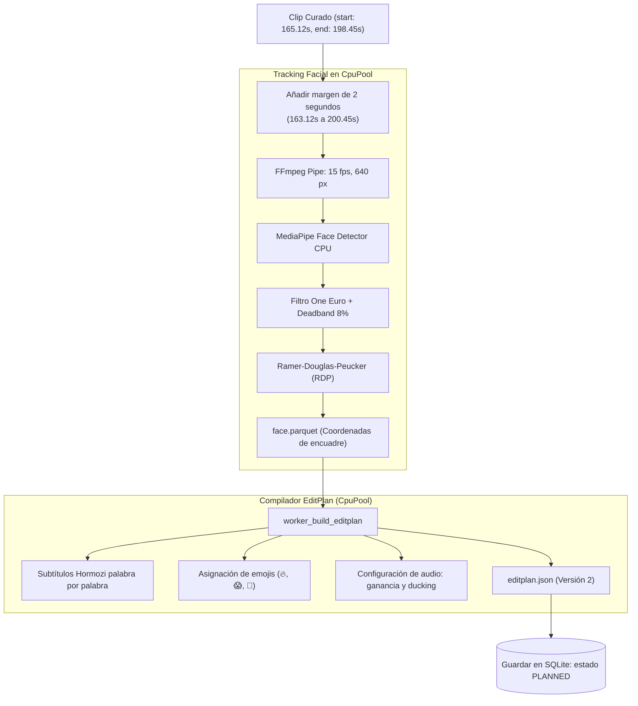

# Flujo 4 · Tracking facial y generación del EditPlan v2

> [!abstract] En pocas palabras
> Cuarto paso del pipeline: por cada clip seleccionado, el sistema localiza la cara del jugador con MediaPipe, calcula los movimientos suaves de cámara y redacta el plano de edición digital (EditPlan v2) con subtítulos, emojis y pistas de sonido.

---

## 🗺️ Diagrama del proceso por clip

---

## 🧭 Paso a paso detallado

### Paso 1: Aislamiento del fragmento de cámara
En lugar de analizar la cámara completa de 2 horas, el orquestador toma el intervalo exacto del clip con un margen de 2 segundos antes y después.

### Paso 2: Rastreo facial y estabilización geométrica
El `CpuPool` extrae las coordenadas de la cara a 15 cuadros por segundo:
- Si el streamer se mueve rápido, el filtro **[[Glosario#One Euro Filter|One Euro Filter]]** acompaña el movimiento sin retraso.
- Si el streamer solo respira o habla quieto, la **[[Glosario#Deadband|Deadband]]** bloquea cualquier temblor de la cámara virtual.
- El algoritmo **[[Glosario#RDP|RDP]]** comprime la trayectoria en unos pocos puntos clave (`CropKeyframe`).

### Paso 3: Compilación del [[Glosario#EditPlan|EditPlan v2]]
El director `hormozi.py` genera el archivo JSON declarativo:
1. Divide el video en relación vertical: 40 % superior para el rostro centrado y 60 % inferior para el videojuego.
2. Formatea los subtítulos con tipografía `Montserrat ExtraBold`, asignando el color amarillo (`#FFD400`) a la palabra activa y verde (`#39FF14`) a las palabras con énfasis acústico.
3. Detecta palabras emocionales (p. ej. *increíble, fuego, rey, cuidado*) e inserta los identificadores de emojis correspondientes.
4. Define la mezcla de audio: ganancia de voz en $+2.0\text{ dB}$, atenuación del juego en $-9.0\text{ dB}$ (**[[Glosario#Ducking Sidechain|Ducking]]**) y disparo del efecto `sfx/boom.wav`.

---

## 🔗 Relacionado
- [[Flujo 3 Curación con LLM]]
- [[Flujo 5 Edición Interactiva en Web Studio]]
- [[Tracking Facial en CPU]]
- [[Contrato EditPlan v2]]
- [[ADR-003 Tracking Facial por Clip en CPU]]