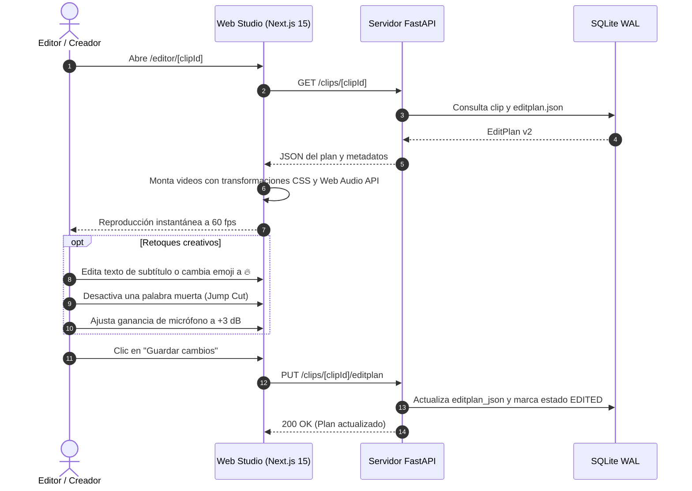

# Flujo 5 · Edición interactiva en Web Studio (`/editor/[clipId]`)

> [!abstract] En pocas palabras
> Quinto paso del pipeline (opcional para el creador): permite abrir cualquier clip en el navegador web para retocar subtítulos, cambiar emojis, ajustar el volumen o corregir el encuadre de la cámara con previsualización inmediata sin esperas de renderizado.

---

## 🗺️ Diagrama de interacción

---

## 🧭 Paso a paso detallado

### Paso 1: Carga y reproducción sin latencia
El editor web no descarga un archivo de video renderizado. En su lugar:
- Carga el archivo original de cámara y el de juego directamente mediante peticiones HTTP con soporte de rangos parciales (`206 Partial Content`).
- Aplica las propiedades de recorte, escalado y encuadre del **[[Glosario#EditPlan|EditPlan v2]]** mediante transformaciones CSS de hardware (`transform: translate3d(...) scale(...)`).
- Los subtítulos animados y los emojis se dibujan en una capa superior de `<canvas>` a 60 fotogramas por segundo sincronizados con el reloj del video.

### Paso 2: Mezcla sonora en tiempo real
Utiliza el grafo de nodos de la **[[Glosario#Web Audio API|Web Audio API]]** en JavaScript:
- Aplica el nivel `mic_gain_db` a la pista del micrófono.
- Reduce dinámicamente el volumen del juego mediante un nodo atenuador (`duck_game_db`).
- Dispara los efectos de sonido (`sfx/boom.wav`) en la posición temporal exacta indicada por el plan.

### Paso 3: Persistencia y preservación de ediciones manuales
Cuando el creador guarda sus cambios:
- Se envía el nuevo objeto JSON a la ruta `PUT /clips/{clip_id}/editplan`.
- El servidor guarda el archivo `editplan.user.json` en disco y actualiza la base de datos marcando el estado en `EDITED`.
- **Garantía de preservación**: Si la sesión completa se vuelve a procesar automáticamente en el futuro, el orquestador respeta las modificaciones manuales del usuario y no sobrescribe los clips que se encuentren en estado `EDITED`.

---

## 🔗 Relacionado
- [[Flujo 4 Tracking y Generación EditPlan]]
- [[Flujo 6 Renderizado y Normalización]]
- [[Motor de Edición Web Studio]]
- [[Cómo usar el Editor Web Studio]]