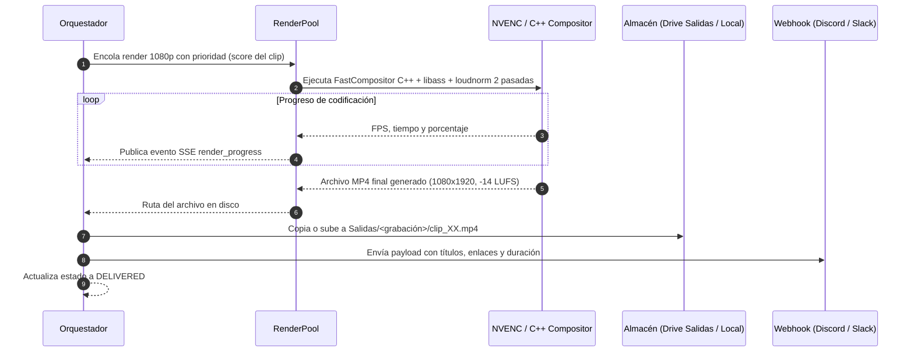

# Flujo 6 · Renderizado en GPU y normalización sonora

> [!abstract] En pocas palabras
> Paso final del pipeline: exporta el video vertical en resolución $1080 \times 1920$ a 60 fps con aceleración en tarjeta gráfica NVIDIA, quema los subtítulos animados en el video, fija el volumen a -14 LUFS y lo entrega en tu carpeta de salida y por Discord.

---

## 🗺️ Diagrama del proceso de exportación

---

## 🧭 Paso a paso detallado

### Paso 1: Encolado con prioridad en `RenderPool`
Las peticiones de render se ordenan dinámicamente según la puntuación de calidad del clip (`final_score`). Los mejores momentos se exportan primero.
- Se adquiere un slot en el semáforo de hardware NVIDIA (**[[Glosario#NVENC|NVENC]]**).
- Si la GPU está ocupada o no existe, conmuta automáticamente a la CPU con **[[Glosario#libx264|libx264]]**.

### Paso 2: Renderizado compuesto en C++ y quemado de subtítulos
1. **`FastCompositor`**: Genera la composición vertical combinando los fotogramas del juego y la cámara mediante transformaciones afines en C++ (`cv2.warpAffine`), aplicando los zooms y paneos dinámicos.
2. **`libass`**: Renderiza la pista de subtítulos `.ass`, aplicando el resaltado de color palabra por palabra, escalado de énfasis tipográfico y títulos en la línea divisoria.

### Paso 3: Normalización sonora estricta en 2 pasadas
Para garantizar que el clip no suene ni muy bajo ni saturado en redes sociales:
- **Pasada 1**: Mide la sonoridad integrada del audio mezclado.
- **Pasada 2**: Aplica la ganancia lineal exacta para fijar el audio en **$-14\text{ LUFS}$** con verdadero pico (*True Peak*) a $-1.0\text{ dBTP}$.

### Paso 4: Entrega final y notificación
1. El archivo resultante se nombra de forma limpia (p. ej. `clip_01_clutch_imposible.mp4`) y se almacena en `data/sessions/<id>/renders/`.
2. Si Google Drive está habilitado, se sube de forma resumible a la subcarpeta `Salidas/<nombre_grabación>/`.
3. Se dispara una notificación HTTP POST al **[[Glosario#Webhook|Webhook]]** de Discord o Slack configurado con los datos de publicación (título sugerido, hashtags y enlace al clip).

---

## 🔗 Relacionado
- [[Flujo 5 Edición Interactiva en Web Studio]]
- [[Motor de Renderizado y Subtítulos]]
- [[Pools de Trabajo]]
- [[Cómo exportar y renderizar clips]]