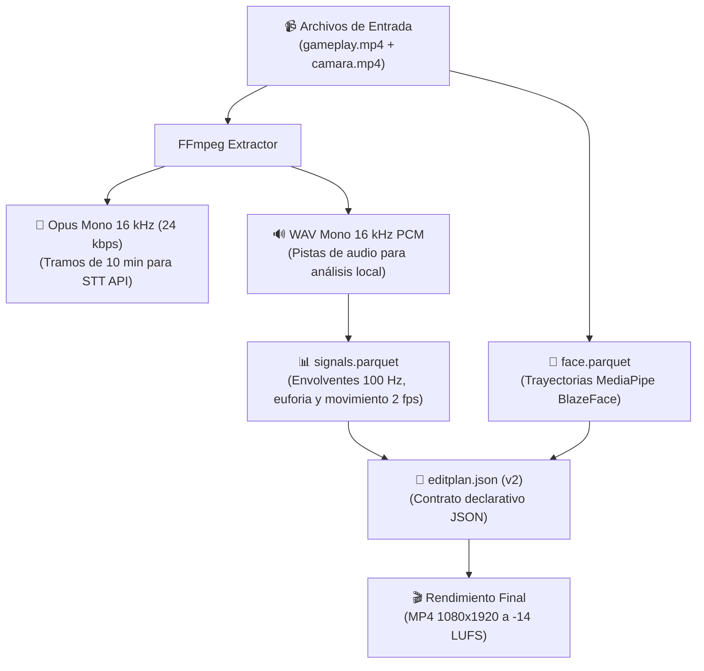

# Estructuras y Formatos de Archivos

> [!abstract] En pocas palabras
> Guía técnica de los formatos de archivo utilizados para almacenar señales acústicas, trayectorias faciales, planes de edición y audio comprimido en el disco local de FarmClips.

---

## 🗺️ Mapa de formatos y artefactos

---

## 📁 1. Señales acústicas y visuales (`signals.parquet`)

Generado por el módulo `clipscore` y serializado en formato columnar Apache Parquet mediante `pyarrow`. Cada fila representa **un segundo de tiempo** de la grabación:

| Columna | Tipo | Rango | Descripción |
|---|---|---|---|
| `sec` | `int64` | $0 .. N$ | Segundo absoluto de la línea de tiempo master. |
| `mic_loudness` | `float64` | $[0.0, 1.0]$ | Nivel de sonoridad sostenida en el micrófono. |
| `mic_burst` | `float64` | $[0.0, 1.0]$ | Picos súbitos de volumen (gritos o risas). |
| `game_loudness` | `float64` | $[0.0, 1.0]$ | Nivel sonoro del videojuego (disparos o explosiones). |
| `motion` | `float64` | $[0.0, 1.0]$ | Magnitud de cambio visual por flujo óptico a 2 fps. |
| `motion_cx` | `float64` | $[0.0, 1.0]$ | Centro de masa horizontal del movimiento en pantalla. |
| `hud_activity` | `float64` | $[0.0, 1.0]$ | Actividad visual en la zona de bajas (*Killfeed*). |
| `reaction` | `float64` | $[0.0, 1.0]$ | Correlación entre pico de juego y reacción del streamer. |
| `excitement` | `float64` | $[0.0, 1.0]$ | Métrica compuesta de emoción para el LLM. |

> [!info]- Metadatos embebidos en el esquema Parquet
> El archivo Parquet incluye metadatos binarios en su encabezado:
> - `duration`: Duración total del VOD en segundos.
> - `peaks_json`: Lista JSON con los momentos de máxima intensidad que superaron el percentil 90.

---

## 👤 2. Trayectoria de Tracking Facial (`face.parquet`)

Almacena las coordenadas del rostro detectado por MediaPipe por cada clip:

| Columna | Tipo | Descripción |
|---|---|---|
| `t_master` | `float64` | Segundo de tiempo en la línea temporal master del VOD. |
| `present` | `bool` | `true` si el rostro fue detectado; `false` si hubo oclusión. |
| `cx` | `float64` | Centro horizontal del rostro normalizado ($0.0 = \text{izq}, 1.0 = \text{der}$). |
| `cy` | `float64` | Centro vertical del rostro normalizado ($0.0 = \text{arriba}, 1.0 = \text{abajo}$). |
| `size` | `float64` | Tamaño relativo del bounding box del rostro ($0.0 .. 1.0$). |
| `confidence` | `float64` | Nivel de confianza del detector de MediaPipe ($0.0 .. 1.0$). |

---

## 🎵 3. Formatos de Audio Intermedios

1. **Opus Mono $16\text{ kHz}$ (`.opus`)**:
   - Tasa de bits: $24\text{ kbps}$ constante.
   - Tamaño: $\sim 1.8\text{ MB}$ por cada bloque de 10 minutos.
   - Finalidad: Envío ultraligero a la API de Speech-to-Text.
2. **WAV Mono $16\text{ kHz}$ PCM 16-bit (`.wav`)**:
   - Formato sin pérdidas ni compresión para el análisis de Fourier y cálculo de envolventes acústicas a 100 Hz.

---

## 🔗 Relacionado
- [[Modelo de datos]]
- [[Contrato EditPlan v2]]
- [[Núcleo de Señales y Selección]]
- [[Tracking Facial en CPU]]