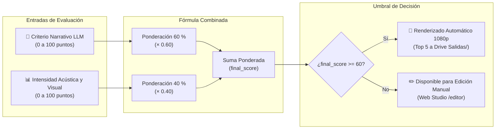

# Indicadores, fórmulas y métricas clave

> [!abstract] En pocas palabras
> Fórmulas matemáticas y valores de referencia para evaluar la calidad narrativa de los clips, el control del presupuesto en dólares, los tiempos de procesamiento y los estándares de sonoridad en decibelios.

---

## 🗺️ Modelo de ponderación del score

---

## 🎯 1. Puntuación de Calidad del Clip (`final_score`)

FarmClips combina la evaluación semántica de la inteligencia artificial con las medidas físicas de intensidad acústica y visual para priorizar qué videos exportar primero:

$$\text{final\_score} = 0.60 \cdot \text{llm\_score} + 0.40 \cdot \text{signal\_score}$$

- **`llm_score` ($0 .. 100$)**: Calificación otorgada por el LLM evaluando el gancho narrativo (*hook*), la sorpresa, el humor o la tensión dramática del diálogo.
- **`signal_score` ($0 .. 100$)**: Puntuación percentil del promedio de euforia acústica y movimiento en el fragmento seleccionado.

> [!example] Ejemplo numérico de cálculo de score
> En una jugada de *Counter-Strike*:
> - El LLM califica el diálogo con $92 / 100$ por la emoción del clutch final.
> - El análisis de señales detecta un grito prolongado y racha de bajas en el killfeed, arrojando $85 / 100$.
> - $\text{final\_score} = (0.60 \times 92) + (0.40 \times 85) = 55.2 + 34.0 = \mathbf{89.2} / 100$.
> - Al superar el umbral de 60 puntos (`auto_render_min_score`), el clip entra automáticamente en la cola de renderizado 1080p.

---

## 💰 2. Presupuesto y Costos de IA por Sesión

Calcula el gasto acumulado en tiempo real a partir del consumo reportado en la tabla `api_calls`:

$$\text{Costo Total} = \sum (\text{segundos\_stt} \times P_{\text{stt}}) + \sum (\text{tokens\_prompt} \times P_{\text{in}}) + \sum (\text{tokens\_completion} \times P_{\text{out}})$$

| Proveedor | Tarifa aproximada (USD) | Consumo en sesión de 2 horas | Costo típico |
|---|---|---|---|
| **Deepgram Nova-3** | \$0.0043 por minuto de audio | 120 minutos | **\$0.052 USD** |
| **Google Gemini 3.5 Flash** | \$0.075 / 1M tokens entrada | ~80,000 tokens | **\$0.006 USD** |
| **Groq Whisper Turbo (Backup)** | \$0.0018 por minuto de audio | Respaldo en caso de fallo | < \$0.030 USD |
| **Total Promedio por Sesión** | – | **2 horas de VOD completo** | **~\$0.06 – \$0.12 USD** |

Límite de seguridad configurado por defecto: **`CLIPS_MAX_BUDGET_USD = 9.00`**.

---

## 🔊 3. Estándares de Sonoridad Acústica (EBU R128 / ITU-R BS.1770)

Para garantizar que el sonido no sea silenciado ni atenuado por los algoritmos de compresión de YouTube, TikTok e Instagram:

| Métrica | Valor objetivo | Tolerancia | Propósito |
|---|:---:|:---:|---|
| **Sonoridad Integrada ($I$)** | **$-14.0\text{ LUFS}$** | $\pm 0.5\text{ LUFS}$ | Nivel de volumen medio percibido en plataformas móviles. |
| **Rango de Sonoridad ($LRA$)** | **$11.0\text{ LU}$** | $\pm 2.0\text{ LU}$ | Mantiene claridad entre susurros y gritos sin saturar. |
| **Pico Verdadero ($True\ Peak$)** | **$-1.0\text{ dBTP}$** | Máx. $-0.8\text{ dBTP}$ | Evita distorsiones inter-sample al comprimir a AAC. |

---

## ⚡ 4. Tiempos de Entrega (*Turnaround Time*)

Medido en una máquina con procesador Ryzen 7 / Core i7 y GPU RTX 4060:

| Etapa del pipeline | Duración típica | Modo de ejecución |
|---|---|---|
| Ingesta y Sincronización XCorr FFT | 20 – 35 segundos | CPU local |
| Transcripción (2 h de audio) | 15 – 25 segundos | API Deepgram concurrente |
| Curación y Selección LLM | 8 – 12 segundos | API Gemini Flash |
| Tracking facial por clip (5 clips) | 30 – 45 segundos | CPU local (MediaPipe 15 fps) |
| Render final 1080p (NVENC) | 35 – 50 s por clip | GPU NVIDIA |
| **Tiempo total para 5 Shorts 1080p** | **$\approx 3.5\text{ a }5.0\text{ minutos}$** | Pipeline paralelo continuo |

---

## 🔗 Relacionado
- [[Modelo de datos]]
- [[Monitoreo y Presupuesto]]
- [[Flujo 6 Renderizado y Normalización]]
- [[Motor de Renderizado y Subtítulos]]