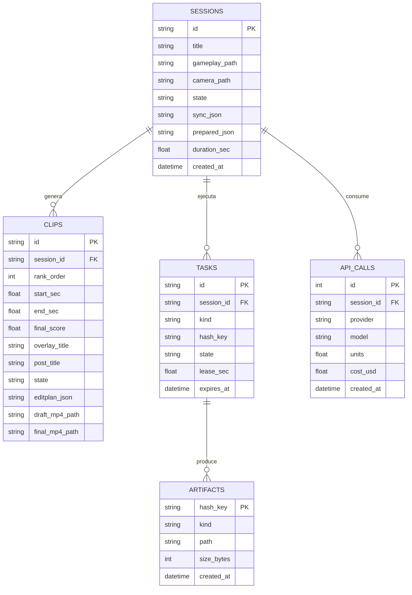

# Modelo de datos relacional (SQLite WAL)

> [!abstract] En pocas palabras
> Describe las tablas y relaciones de la base de datos local `clipsapp.db`. Almacena el historial de grabaciones, clips generados, tareas en ejecución, llamadas a APIs con su costo en dólares y la memoria caché de archivos intermedios.

---

## 🗺️ Diagrama Entidad-Relación (ER)

---

## 📊 Diccionario de tablas principales

### 1. `sessions` (Grabaciones VOD procesadas)
- `id` (TEXT, PK): Identificador único con prefijo temporal (p. ej. `ses_20261107_ab12`).
- `state` (TEXT): Estado actual de la máquina de estados (`NEW`, `PREPARED`, `TRANSCRIBED`, `CURATED`, `PLANNING`, `RENDERING`, `DELIVERED`, `FAILED`).
- `sync_json` (TEXT): Objeto JSON con el `SyncResult` (desfase temporal `shift_sec` y `scale`).
- `prepared_json` (TEXT): Metadatos técnicos de los archivos de video e intervalos de silencio.

### 2. `clips` (Momentos destacados curados)
- `id` (TEXT, PK): Identificador único (p. ej. `clip_01_clutch`).
- `session_id` (TEXT, FK): Vínculo con la sesión contenedora.
- `rank_order` (INTEGER): Posición en el ranking de calidad (1 = mejor clip).
- `start_sec` y `end_sec` (REAL): Tiempos en segundos en la línea temporal original.
- `llm_score`, `signal_score`, `final_score` (REAL): Puntuaciones entre 0.0 y 100.0.
- `state` (TEXT): Estado de edición del clip (`CURATED`, `PLANNED`, `EDITED`, `RENDERING_FINAL`, `RENDERED`, `DELIVERED`).
- `editplan_json` (TEXT): Contrato declarativo **[[Glosario#EditPlan|EditPlan v2]]** completo.

### 3. `tasks` y `artifacts` (Motor de caché e idempotencia)
- `tasks`: Controla qué proceso está calculando qué tarea para evitar ejecuciones concurrentes duplicadas mediante un arrendamiento temporal (**[[Glosario#Leases|lease]]**).
- `artifacts`: Mapea hashes deterministas SHA-256 (`hash_key`) a rutas reales de archivos en disco. Si el hash ya existe, el sistema lee el archivo sin volver a computarlo.

### 4. `api_calls` (Auditoría y control de presupuesto)
- Registra cada consumo hacia Deepgram, Groq, Gemini u OpenAI.
- Contabiliza `units` (segundos de audio o tokens procesados) y calcula `cost_usd` en tiempo real para aplicar el límite de seguridad `CLIPS_MAX_BUDGET_USD`.

---

## 🔗 Relacionado
- [[Estructuras y Formatos de Archivos]]
- [[Indicadores y métricas]]
- [[FastAPI y Orquestador]]
- [[ADR-005 Caché Idempotente y Límite de Presupuesto]]