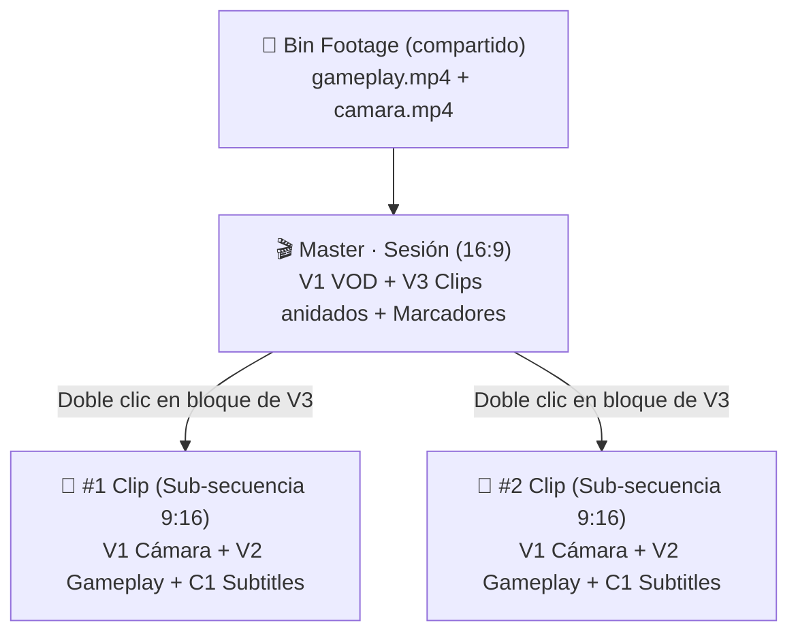

# 🎬 Cómo abrir un clip en FilmCraft

> [!abstract] En pocas palabras
> Pasa de la previsualización web de FarmClips a un entorno de edición no lineal (NLE) profesional en **FilmCraft** con un solo clic, sin mover archivos manualmente y con todas las pistas sincronizadas al milisegundo.

---

## 🚀 Paso a Paso

1. **Abre cualquier clip en el Web Studio:**
   - Entra a `http://127.0.0.1:3040/editor/[clipId]`.
2. **Revisa tus cortes y ajustes rápidos:**
   - Puedes ajustar subtítulos, volumen, encuadre o cortes.
3. **Haz clic en el botón «Abrir en FilmCraft»:**
   - Ubicado en la barra superior junto a «Guardar cambios».
   - Si tenías cambios sin guardar, FarmClips los guarda automáticamente antes de exportar.
4. **FilmCraft se abre automáticamente:**
   - Si FilmCraft ya estaba abierto con su bridge activo, el proyecto se cargará en la ventana existente sin abrir procesos duplicados y se traerá al frente.
   - Si no estaba abierto, se iniciará con la secuencia vertical (1080×1920) lista y selección automática del backend gráfico óptimo (`DirectX 12` / `Vulkan`).
   - En la interfaz web aparecerá un banner de éxito con opciones adicionales:
     - `[📁 Abrir carpeta]`: Abre el Explorador de Windows con el archivo `.fcproj` seleccionado directamente.
     - `[📥 Descargar .fcproj]`: Descarga una copia directa del proyecto para respaldos o edición manual.

---

## 🎛️ Pistas que encontrarás en FilmCraft

| Pista | Nombre | Contenido |
|---|---|---|
| **V1** | `V1 Cámara` | Video del streamer (capa base vertical), con seguimiento facial continuo y punch zooms dinámicos sincronizados en `mediaTime`. |
| **V2** | `V2 Gameplay` | Video del juego (capa superior vertical `[768..1920]`), que delimita nítidamente el panel inferior tapando cualquier desborde del zoom de cámara en el corte exacto a $y=768$. |
| **V3** | `V3 Overlays` | Titulares y subtítulos animados con canal alfa transparente (Apple ProRes 4444, desactivada por defecto para dar paso a la edición nativa). |
| **C1** | `C1 Subtitles` | Pista nativa de subtítulos interactivos y editables (puedes hacer doble clic sobre cualquier palabra en el visor o en el panel Captions para cambiar el texto en tiempo real). |
| **A1** | `A1 Mic` | Audio de la voz del streamer con la ganancia configurada. |
| **A2** | `A2 Juego` | Audio del juego con keyframes automáticos de ducking en `mediaTime` (atenuación al hablar). |
| **A3** | `A3 SFX` | Efectos de sonido colocados en sus instantes exactos. |

Además, los subtítulos de cada frase aparecen como **marcadores** en el timeline para que puedas saltar de una frase a otra rápidamente.

---

## 📦 Exportación global de toda la sesión (Master + Sub-secuencias)

Si prefieres trabajar **todos los clips de una sesión en un solo proyecto** sin abrirlos uno por uno:

1. Entra al detalle de tu sesión en `/sessions/[id]`.
2. En la sección **Mejores momentos seleccionados**, usa el botón **Incluido / Incluir** de cada tarjeta (o los atajos **Todos / Ninguno**) para elegir qué clips quieres llevar a [[Glosario#FilmCraft|FilmCraft]].
3. Haz clic en **«Abrir proyecto en FilmCraft (N)»** (o descarga directamente con `.fcproj`).
4. En FilmCraft se abrirá un único proyecto `session.fcproj` con:
   - **Secuencia activa [[Glosario#Master|Master]] · `<Sesión>` (16:9):** línea completa de tu grabación de principio a fin (`V1 VOD Gameplay`, `V2 VOD Cámara (Ref)` apagada por defecto, `A1 Mic (VOD)` y `A2 Juego (VOD)` sincronizados), **marcadores** en cada jugada y las pistas **`V3 Clips (Sub-secuencias)`** (y `V4+` si hay solapamientos) con cada clip anidado en sus marcas de tiempo exactas.
   - **Carpeta `Sequences/Clips (9:16)` y pestañas abiertas:** cada clip elegido tiene su propia [[Glosario#Sub-secuencia|sub-secuencia]] vertical 1080×1920 completa (`V1 Cámara`, `V2 Gameplay`, `V3 Overlays`, `C1 Subtitles`, `A1–A3`). Al hacer doble clic sobre un bloque en `V3` (o cambiar de pestaña), pasas directo a editar ese Short.

---

## ⚙️ Configuración y Solución de Problemas

- Si el botón aparece deshabilitado o avisa que no encuentra FilmCraft:
  - Entra a `/settings`.
  - Verifica la sección **FilmCraft NLE & Copiloto MCP**.
  - Si instalaste FilmCraft en una carpeta personalizada, puedes configurar la variable `CLIPS_FILMCRAFT_PATH`.
- Si la ventana ya estaba abierta, FarmClips la trae al frente automáticamente sin cerrar tu sesión actual. Si por permisos de Windows no emerge, usa el botón **`[📁 Abrir carpeta]`** para abrir el archivo `.fcproj` con doble clic.

> [!info]- Detalle técnico: lanzamiento seguro en Windows y control loopback
> - **Control server y token:** FilmCraft requiere `FILMCRAFT_CONTROL_TOKEN` (64 caracteres hexadecimales) para su servidor de control loopback (`127.0.0.1:9876`). FarmClips lo lee desde el entorno o `HKCU\Environment`, o lo genera y persiste automáticamente en `%LOCALAPPDATA%\FilmCraft\.farmclips_control_token` y en `HKCU\Environment`.
> - **Escritorio interactivo (`WinSta0\Default`) y bridge MCP:** FarmClips lanza `filmcraft.exe` con `--control <puerto>` (por defecto `9876`) mediante Win32 `CreateProcessW` con `lpDesktop = r"WinSta0\Default"` y `CREATE_BREAKAWAY_FROM_JOB`, heredando `FILMCRAFT_CONTROL_TOKEN` para evitar aislamiento en escritorios virtuales y dejar operativo el bridge TCP para el copiloto MCP `filmcraft`.
> - **Detección de ventana:** Mediante `EnumDesktopWindows` sobre `Default`, si hay ventana visible se trae al frente (`AttachThreadInput` + `SetForegroundWindow`) sin cerrar procesos activos; solo se limpian instancias colgadas sin ventana gráfica.

---

## 🔗 Relacionado
- [[Cómo usar el copiloto con Claude Desktop y Antigravity]]
- [[Motor de Edición Web Studio]]
- [[ADR-006 Integración con FilmCraft y copiloto MCP]]
