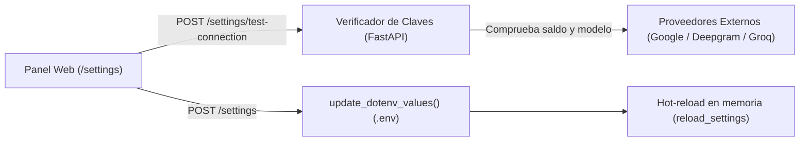

# Cómo configurar Proveedores de IA y Presupuesto

> [!abstract] En pocas palabras
> Guía para dar de alta tus claves de Deepgram, Groq, Gemini y OpenAI, verificar que funcionen con el probador integrado y fijar un límite máximo de dinero en dólares para evitar sustos en tu factura.

---

## 🧭 Panel de Ajustes (`/settings`)

FarmClips dispone de un panel visual interactivo accesible desde cualquier navegador en:
👉 `http://127.0.0.1:3040/settings`

---

## 🔑 Proveedores soportados y cómo obtener sus claves

### 1. Transcripción de Voz ([[Glosario#STT|STT]])

| Proveedor | Modelo recomendado | Dónde obtener la clave | Observaciones |
|---|---|---|---|
| **Deepgram (Principal)** | `nova-3` | [console.deepgram.com](https://console.deepgram.com) | Incluye \$200 USD de crédito gratuito inicial. |
| **Groq (Respaldo)** | `whisper-large-v3-turbo` | [console.groq.com](https://console.groq.com) | Transcripción ultrarrápida en hardware LPU. |

### 2. Curación Narrativa con [[Glosario#LLM|LLM]]

| Proveedor | Modelo recomendado | Dónde obtener la clave | Observaciones |
|---|---|---|---|
| **Google Gemini (Principal)** | `gemini-3.5-flash-lite` | [aistudio.google.com](https://aistudio.google.com) | Cuota gratuita muy generosa para desarrolladores. |
| **OpenAI / Compatible (Respaldo)** | `gpt-6-luna` / `gpt-4o-mini` | [platform.openai.com](https://platform.openai.com) | Soporta también URLs locales (Ollama o vLLM). |

---

## 🧪 Comprobación de Conexión en Caliente

Antes de guardar una clave, pulsa el botón **"Probar conexión"** junto al campo de texto. El servidor enviará una petición mínima de prueba:
- Para Deepgram/Groq: Valida que la cabecera `Authorization` sea aceptada.
- Para Gemini/OpenAI: Envía un saludo mínimo de 1 token para comprobar que el modelo solicitado exista y tenga cuota activa.

Si la clave es válida, el indicador cambiará a color verde (`✅ Conexión exitosa`).

---

## 💵 Configuración del Límite de Presupuesto

En el campo **"Presupuesto máximo por sesión (USD)"**:
- El valor predeterminado es **`9.00`** (unos 30.000 COP).
- Si una sesión de video acumula llamadas que se acerquen a esta cifra, el sistema cancela preventivamente las siguientes peticiones y emite una alerta, impidiendo cobros automáticos en tu tarjeta de crédito.

---

## 🔗 Relacionado
- [[Primeros pasos]]
- [[Proveedores de IA y Resiliencia]]
- [[Runbook · Falla de API o Presupuesto Agotado]]
- [[Variables de Entorno]]