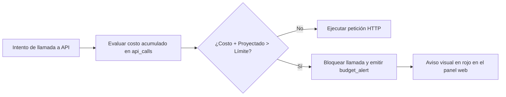

# Monitoreo del sistema y control de presupuesto

> [!abstract] En pocas palabras
> Explica cómo vigilar el avance de las tareas en tiempo real mediante el bus de eventos Server-Sent Events (SSE) y cómo el sistema previene cobros inesperados en dólares deteniendo el procesamiento antes de superar el límite fijado.

---

## 📡 Bus de Eventos en Tiempo Real (SSE)

El orquestador emite eventos estructurados a través del endpoint HTTP:
`GET http://127.0.0.1:8790/events`

Tanto la interfaz web como scripts de monitoreo externos pueden suscribirse a este flujo:

| Evento SSE | Carga útil (*Payload*) | Cuándo se emite |
|---|---|---|
| `session_state` | `session_id, state, message` | Al cambiar de fase en el pipeline. |
| `stage_progress` | `session_id, stage, progress` | Cada 10 % de avance en tareas largas. |
| `render_progress` | `clip_id, quality, progress, fps` | Cuadro a cuadro durante la codificación FFmpeg. |
| `budget_update` | `total_usd, max_budget_usd, pct` | Tras cada llamada de STT o LLM. |
| `clip_updated` | `session_id, clip_id, state` | Al completarse un EditPlan o finalizar un render. |
| `webhook_sent` | `session_id, status_code, url` | Tras notificar a Discord o Slack. |

---

## 💰 Sistema de Protección de Presupuesto (*Budget Guard*)



- **Límite activo**: `CLIPS_MAX_BUDGET_USD` (por defecto \$9.00 USD).
- **Consulta en vivo**: Puedes consultar el gasto acumulado de cualquier sesión con:
  ```powershell
  # En PowerShell
  Invoke-RestMethod -Uri "http://127.0.0.1:8790/budget"
  ```
- **Reanudación segura**: Si el presupuesto se agota, el usuario puede aumentarlo temporalmente desde `/settings` y el orquestador reanudará la sesión desde la fase exacta donde se pausó.

---

## 🔗 Relacionado
- [[Despliegue y Ejecución]]
- [[Mantenimiento y Limpieza]]
- [[Runbook · Falla de API o Presupuesto Agotado]]
- [[Indicadores y métricas]]